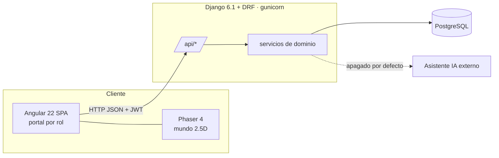
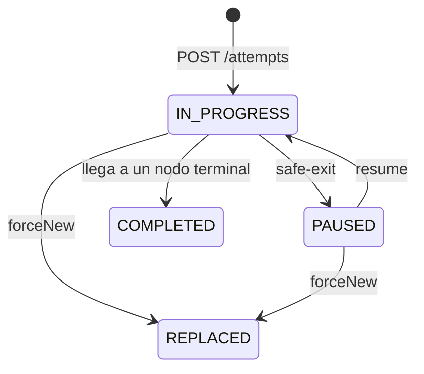

# SIEP — Documento maestro (estado vigente)

> **Qué es.** El documento único para entender SIEP **como funciona hoy**, con el stack de hoy. Sirve a personas y a sesiones de IA sin contexto previo.
>
> - **Corte:** 2026-10-11, sobre `master` @ `985d9a5`.
> - **Reemplaza** a `PROMPT_MAESTRO.md` de junio (Django 5.1, Angular 21, Spring «congelado»), a `PROMPT_MAESTRO_SIEP_PROFESIONAL.md` (julio, sin versionar) y a lo vigente de `PLAN_MAESTRO_TOTAL.md` (que sigue como plan por bloques).
> - **Complementa** a `docs/CONTEXTO_COMPLETO_SIEP.md` (sin versionar, edición 1, corte `92354c2`), la referencia exhaustiva.
> - **Evidencia fina** (`ruta:línea` por afirmación) en `docs/informes/2026-10-10-mapa-del-sistema/secciones/`: son borradores de lectores con verificación adversarial incompleta; lo que sigue aquí es su síntesis, con las cifras recontrastadas.
> - **Mantenimiento:** el PR que cambie comportamiento, stack o reglas actualiza la sección afectada. Manda el código; si este documento y el código discrepan, el documento está mal.

## Índice

0. [En dos minutos](#0-en-dos-minutos) · 1. [Producto, roles y límites](#1-producto-roles-y-límites) · 2. [Stack y entorno](#2-stack-y-entorno) · 3. [Arquitectura](#3-arquitectura) · 4. [Cómo funciona hoy](#4-cómo-funciona-hoy) · 5. [Reglas que el sistema impone](#5-reglas-que-el-sistema-impone) · 6. [Seguridad, ética y privacidad](#6-seguridad-ética-y-privacidad) · 7. [Calidad y verificación](#7-calidad-y-verificación) · 8. [Estado y hoja de ruta](#8-estado-y-hoja-de-ruta) · 9. [Cómo trabajar en el repo](#9-cómo-trabajar-en-el-repo) · 10. [Mapa de documentos](#10-mapa-de-documentos)

---

## 0. En dos minutos

**SIEP — Sistema de Entrenamiento Psicosocial** es un simulador formativo de casos de psicología social (RPG clínico 2.5D) de la Corporación Universitaria Empresarial Alexander von Humboldt (Programa de Psicología, Armenia). El estudiante explora salas, dialoga con NPC, decide y recibe retroalimentación; el docente revisa y evalúa con rúbrica. Es **formativo, no diagnóstico ni examen**.

**Stack:** Django 6.1 + DRF 3.18 (JWT) · Angular 22 (Signals) + Phaser 4 · PostgreSQL · Node 24 en CI · una sola imagen en Railway.

**Estado:** ALPHA cerrada (2026-10-02); un único caso jugable, `SIM-VBG-001`. Todo lo que depende de decisiones del equipo de Psicología (propuestas C, E, F, G y J) está en BETA, sin implementar.

**Ocho hechos que hay que saber antes de tocar nada**

1. **Un solo caso** (`SIM-VBG-001`: 8 nodos, 6 bloques de decisión, 19 opciones, 5 herramientas). Finales, métricas y orientación están atados a él; un segundo caso exige generalizar (bloque J).
2. **Solo ADMIN autora, valida y publica casos.** El profesor recibe 403 en autoría; solo asigna versiones publicadas a sus grupos y revisa.
3. **El esquema de BD tiene tres definiciones** sin sincronía automática: `deploy/db_seed.sql` (producción), `bootstrap_dev_db` (dev y pruebas) y los modelos (25 de 27 son `managed=False`). Los cambios para BDs ya restauradas van a `deploy/upgrades/*.sql` a mano; el despliegue no corre `migrate`.
4. **Intento:** estados `IN_PROGRESS`, `PAUSED`, `COMPLETED`, `REPLACED` (más `SAFE_EXITED`, solo histórico). La primera respuesta mala de cada nodo no se aplica (segunda oportunidad). `forceNew` reemplaza el intento abierto.
5. **Retroalimentación:** el texto autorado de la opción se devuelve **en la respuesta de cada decisión**; el informe completo (final, métricas, línea de tiempo, competencias) llega al cerrar el intento.
6. **Bitácora reflexiva cifrada en reposo** (AES-GCM); el docente de ese estudiante la lee descifrada en la traza.
7. **No hay DSL ni JSON Schema ni import/export de casos.** El taller de DSL (`docs/diseno/dsl/`) lo propone y trae validador; aún no está integrado al producto.
8. **CI:** 6 jobs (secretos, vulnerabilidades, scripts, backend, frontend, e2e). El e2e de recorrido completo y orientación corre de noche, no en el PR.

**Cinco riesgos mayores:** (a) los reportes por grupo no comprueban propiedad: cualquier profesor ve cualquier grupo; (b) secretos de desarrollo por defecto (`JWT_SECRET`, clave de cifrado, contraseña de importados, contraseñas demo versionadas) y producción no rechaza secretos débiles; (c) el consentimiento ETH-01 vive solo en el navegador; (d) sin límite de intentos en login ni en la solicitud de acceso, sin revocación de tokens; (e) sin salud ni observabilidad en producción y esquema con upgrades manuales de orden frágil.

---

## 1. Producto, roles y límites

### Modelo pedagógico
Cada caso es un **grafo dirigido** de nodos clínicos (narrativa, sala, objetos, diálogos). Una **decisión** pertenece a un nodo y tiene opciones clasificadas `ADEQUATE | RISKY | INADEQUATE` (con marca de **conducta prohibida** y su razón). Hablar con un NPC y elegir una respuesta *es* decidir. El backend es la única autoridad del puntaje; el cliente solo presenta. Evaluación **por competencias y rúbrica**, no por acierto único.

### Roles (la autoridad es el servidor, que lee el rol de la BD en cada petición)

| Rol | Puede | No puede |
|---|---|---|
| **ESTUDIANTE** | Ver su catálogo (casos publicados asignados a un grupo activo suyo), jugar, pausar y reanudar, escribir bitácora, ver su historial y reporte propio, editar su avatar | Autorar, ver rúbricas ni comentarios docentes, ver reportes |
| **PROFESOR** | Crear y administrar **sus** grupos, agregar estudiantes por correo o importación `.xlsx` (crea cuentas de estudiante), asignar/retirar versiones publicadas, revisar trazas de **sus** estudiantes, evaluar con rúbrica, gestionar rúbricas, reportes y CSV | Autorar casos, crear profesores o admins, jugar (no inicia intentos) |
| **ADMIN** | Todo lo de autoría (casos, versiones, mundo, herramientas, checklist, publicar, clonar), usuarios (crear, editar, activar/desactivar, asignar rol), solicitudes de acceso, juego, trazas y reportes de todos | Administrar grupos de un profesor (solo lista) |

### Límites éticos y clínicos
- Contenido sobre violencia basada en género (casos ficticios). **Formativo**: nada se usa para diagnóstico. Repo y despliegue de datos sensibles: repo privado desde 2026-09-29; sin datos reales de pacientes.
- **ETH-01** (consentimiento antes de contenido sensible) y **ETH-02 / REGLA-004** (la salida segura siempre alcanzable y es una **pausa reanudable**, no un abandono) son invariantes del producto.
- La **línea base académica PN3** (§8) exige además RN-01: casos de psicología social con fines educativos, sin diagnóstico clínico.

---

## 2. Stack y entorno

| Pieza | Versión / detalle |
|---|---|
| Python | 3.14 en imagen y CI; `npm run up` acepta 3.12–3.14 |
| Django · DRF · simplejwt | 6.1.1 · 3.18.1 · 5.5.1 |
| Backend (resto) | psycopg 3.3.6, cors-headers 4.9.0, cryptography 50.0.2, drf-spectacular 0.30.0, bcrypt 5.0.0, google-auth 2.59.1, requests 2.34.2, gunicorn 26.2.0, whitenoise 6.12.0, dj-database-url 3.1.2 |
| Angular (core, cdk, material, build, cli) | 22.2.1 (zoneless por defecto; `zone.js` sigue como polyfill) |
| Phaser · Konva · Howler | 4.2.1 · 10.7.0 (solo editor de mundo) · 2.2.4 |
| TypeScript · RxJS | 6.0.3 (Angular 22 exige `>=6.0 <6.1`; no subir a 7) · 7.8.2 |
| Pruebas | pytest 9.1.1 + pytest-django (`--reuse-db --nomigrations`); Vitest 5.0.3 + jsdom (no hay Jest); Playwright 1.63.0 (1 worker) |
| PostgreSQL | **dev 16-alpine** (volumen `psychosim-db`; no subir de mayor), pruebas 18-alpine en tmpfs, producción gestionada por Railway (volcado de 16.13) |
| Node | **24** en CI; el Dockerfile quedó en `node:26-alpine` por Dependabot (#20) y **no tiene prueba** (Angular declara `^22.22.3 \|\| ^24.15.0 \|\| >=26.0.0`) |

**Comandos de la raíz** (`package.json`): `npm run up` (BD + venv + guarda de esquema + Django :8091 + Angular :4200) · `npm run down` (para la BD, conserva el volumen) · `db:bootstrap -- --yes` (siembra esquema, `SIM-VBG-001` y grupo `DEMO1`) · `test:scripts` · `check:backend` · `test:backend` · `test:api:e2e` (stack aislado, matriz de 16 comprobaciones) · `test:e2e` (matriz + Playwright) · `test:frontend` (Vitest) · `build:frontend`.

**Puertos:** BD dev 5433 (`SIEP_DB_PORT`) · Django 8091 · Angular 4200 (4300 en la vista previa) · BD de pruebas 5544 (`SIEP_TEST_DB_PORT`) · e2e: API 8093 y web 4315 · contenedor `$PORT` o 8000.

**Reglas de entorno:** la BD de desarrollo es propia de cada checkout (labels de Compose y `working_dir`); `npm run up` **nunca** hace bootstrap por su cuenta y se detiene si faltan las tablas centinela. Las pruebas usan una BD desechable con nombre, contraseña y nonce aleatorios y se niegan a correr contra la de desarrollo. **Windows:** Bash tiene el PATH roto (usar PowerShell); Python de la Microsoft Store crea venvs rotos (usar `C:\Python313\python.exe`); fin de línea LF por `.gitattributes`.

**Despliegue:** Railway construye el `Dockerfile` (Angular compilado + gunicorn, 3 workers, `psychosim.settings.production`); cada push a la rama conectada redepliega; **no corre `migrate`**; la BD se restaura a mano con `deploy/db_seed.sql` y los upgrades de `deploy/upgrades/` (3 scripts idempotentes) en orden. Producción exige `DJANGO_SECRET_KEY` (rechaza el valor por defecto), `JWT_SECRET`, hosts y `DB_PASSWORD` sin `DATABASE_URL`.

---

## 3. Arquitectura

**Monorepo** `psico_project_v3/`: `backend_django/` · `frontend/` · `deploy/` (volcado y upgrades) · `scripts/` (entorno y pruebas, `.mjs`) · `tools/` (arte de puertas y mobiliario) · `docs/`.

### Backend (`backend_django/`)
| App | Responsabilidad |
|---|---|
| `users` | Identidad (`CustomUser`, roles, bcrypt), login con correo/clave y Google, JWT HS256 de 8 h, solicitudes de acceso, gestión por el admin |
| `grupos` | Grupos del profesor, membresías (SQL crudo), importación `.xlsx`, asignación de versiones publicadas |
| `simulation` | El núcleo: modelos de caso/mundo/intento/rúbrica, autoría (`services/authoring/*`), motor del intento (`game_service`, `attempt_lifecycle`, `decision_effects`, `case_effects`), runtime del mundo (`world_service`, `door_chain`), validación (`world_validation`), cifrado, auditoría, asistente IA |
| `reportes` | Dashboard, reporte por grupo y CSV (solo simulador) |
| `progression` | Casos completados y catálogo con desbloqueo lineal (tabla gestionada por Django) |
| `shared` | Sobre de respuesta `{success,message,data}`, excepciones, permisos por rol |

Settings en `psychosim/settings/`: `base`, `local` (copia gitignored de `local.example.py`), `test` (aislada, con atestación) y `production` (aborta si faltan secretos). JWT firmado con el `SECRET_KEY` de Django; `JWT_SECRET` solo es la clave por defecto del cifrado.

### Frontend (`frontend/src/app/`)
`core/` (auth, guardas, API por rol, modelos), `shared/` (shell, avisos, confirmaciones), `features/`: `login`, `public` (portada), `dashboard`, `admin` (usuarios y solicitudes), `grupos`, `reportes`, `character` (editor del avatar y kit por código) y `simulator` (catálogo, juego, editor de casos, traza docente; el 80 % del código). Rutas en `app.routes.ts`: portada `/`, `/login`, portal `/portal/**` con `authGuard` y `roleGuard`. **Dos componentes enormes** concentran el runtime: `simulation-play.component.ts` (~3.060 líneas) y `game-world.component.ts` (~2.840, escena Phaser).

### Datos y esquema
27 modelos, 25 `managed=False`; gestionados por Django: `access_requests` y `student_case_completion`. El volcado (`pg_dump` 16.13, 41 tablas, 6 CHECK, 61 FK) manda en producción; hay una prueba de contrato que cruza 4 de los 6 CHECK con los `TextChoices`. Columnas JSON son TEXT. La estrategia de esquema (Django dueño, despliegue en Hetzner) está en `docs/arquitectura/estrategia-stack-esquema-y-despliegue.md` y **no se ha ejecutado**.

---

## 4. Cómo funciona hoy

### Ciclo de vida del caso (autoría, solo ADMIN)
`DRAFT → PUBLISHED` es la única transición por API (`IN_REVIEW` y `ARCHIVED` existen en el enum y el CHECK, sin ruta; no hay archivar ni borrar). Toda mutación exige `DRAFT`; una versión publicada es inmutable y se **clona** (siguiente menor, copia declarativa en transacción). Publicar exige: checklist de 6 casillas al 100 % **y** validación del mundo sin errores (un nodo inicial, ≥ 1 terminal, sin ciclos, geometría dentro del mapa, ≥ 1 objeto `EXIT`, conducta prohibida con razón, límites de tamaño). Publicar **no** archiva la versión anterior: coexisten varias PUBLISHED.

### Ciclo de vida del intento (estudiante)

- **Iniciar:** versión PUBLISHED de un caso activo y, para estudiantes, asignada a un grupo activo suyo. Sin `forceNew`, si hay un intento abierto lo devuelve (y reemite su token).
- **Token del intento:** 32 bytes aleatorios (se guarda el SHA-256); viaja en `X-SIEP-Attempt-Token` (GET) o en el cuerpo. Un token rotado anula a la otra pestaña.
- **Decisión:** solo desde el nodo actual. La **primera** respuesta RISKY/INADEQUATE/prohibida de un nodo no se aplica ni avanza (aviso de «última oportunidad»); la segunda se registra y avanza. Efectos: puntaje (`score_delta` + penalización), estrés, confianza y riesgo (acotados 0–100; conducta prohibida +40 estrés, −20 confianza, +15 riesgo). 19 opciones canónicas del caso 1 activan banderas y 7 métricas; al completar se resuelve uno de **4 finales** (integral, brechas, riesgo persistente, crítico).
- **Pausa (`safe-exit`) y reanudación:** misma `attemptId`, nodo y métricas; sin bloquear la bitácora; idempotentes. **No** existe un checkpoint aparte: cada operación persiste su efecto al instante.
- **Bitácora:** una nota por (intento, nodo), editable mientras se juega; se bloquea al completar o reemplazar.
- **Mundo (autoritativo en el servidor):** movimiento validado por colisión y velocidad; interacción a ≤ 120 px; herramientas del inventario con pertinencia; puertas encadenadas (existe → destino → cerca → inspeccionado → herramientas → nodos → NPC). Cambiar de sala no cambia el nodo del grafo ni el puntaje.

### Qué ve el estudiante
Catálogo → aviso de contenido (ETH-01) → introducción (solo en `hospital-urgencias`) → mundo con HUD, tarjeta «Qué hacer», diálogos con opciones sin clasificación → «Supervisión clínica» tras decidir (mensaje del servidor, sin cifras) → resultado al cerrar. Salida segura desde cualquier superposición (Esc encadena ayuda → bitácora → diálogo → pausa).

### Qué ve el docente
Hasta 20 intentos recientes de **sus** grupos (alias `Estudiante-N`), traza completa (eventos, línea de tiempo, nodos, reintentos, bitácoras descifradas), evaluación con rúbrica (nota por criterio 1,0–5,0, total ponderado), reportes por grupo y CSV (12 columnas; con nombre y apellido).

### Rutas de la API (`/api`, JWT salvo lo público)
| Grupo | Rol | Notas |
|---|---|---|
| `auth/login`, `auth/google`, `auth/google/config`, `auth/access-request` | público | Google solo reconoce cuentas existentes |
| `auth/me`, `auth/register` | sesión / ADMIN | |
| `admin/users`, `admin/access-requests` | ADMIN | crear, editar, activar/desactivar |
| `admin/cases/**` | ADMIN | autoría, mundo, validar, publicar, clonar |
| `grupos/**` | PROFESOR (lista: +ADMIN) | membresías, importación, casos |
| `simulation/cases`, `attempts`, `…/decisions`, `…/reflections`, `…/safe-exit`, `…/resume`, `…/world`, `…/world-state`, `catalog`, `ai-assistant` | ESTUDIANTE/ADMIN | `ai-assistant` responde 404 salvo bandera |
| `instructor/**`, `rubrics/**`, `reportes/**` | PROFESOR/ADMIN | traza y evaluación por grupo; reportes **sin** control de propiedad |
| `/schema/`, `/swagger-ui.html` | público | también en producción |

Todas las respuestas llevan el sobre `{success, message, data}`; 401 sin token, 403 con rol incorrecto, 500 genérico.

---

## 5. Reglas que el sistema impone

| Regla | Dónde se impone | Estado |
|---|---|---|
| Solo ADMIN autora; toda mutación exige `DRAFT` | `authoring/guards.py` | Cumplida |
| Publicar exige checklist al 100 % y validación limpia | `authoring/publication.py` | Cumplida (validación incompleta: no revisa nodos sin salida ni alcanzabilidad) |
| El estudiante solo inicia casos asignados a su grupo | `game_service.start_attempt` | Cumplida al iniciar; el lobby `/catalog` no filtra por asignación |
| Un intento abierto por (estudiante, caso) | `game_service` (sin índice único) | Parcial: sin bloqueo, dos peticiones simultáneas pueden duplicar |
| Segunda oportunidad por nodo | `game_service.choose_decision` | Cumplida |
| Una versión publicada no se muta | `ensure_draft`, `clone_version` | Cumplida en la API; la rompe `seed_caso_pdf` |
| El servidor es dueño del mundo (posición, puertas, herramientas) | `world_service`, `door_chain` | Cumplida |
| Las opciones solo viajan con `id` y `text` antes de decidir | `game_dtos` | Cumplida |
| La bitácora se cifra en reposo | `crypto_service` | Cumplida (clave única, sin rotación) |
| La auditoría nunca interrumpe la operación | `@auditable` | Cumplida; solo escribe, nada la lee; retención 360 días |
| Un profesor ve solo a sus estudiantes en traza y evaluación | `instructor_service` | Cumplida; **no** en reportes ni en `student-report` |
| Salida segura siempre alcanzable (REGLA-004) | cliente + `safe_exit` | Cumplida en todos los estados jugables (Playwright + axe); sin lector de pantalla real |

**Reglas de oro del plan** (`PLAN_MAESTRO_TOTAL.md`): 001 no tocar Spring (sin objeto: ya no existe) · 002 «sin migraciones Django» (rota en la práctica: `progression` y `AccessRequest` son gestionados) · 003 `ScenarioConfig` coexiste con lo BD-driven · **004 salida segura** · **005 `PUBLISHED` no se muta** · 006 auditoría no interrumpe · 007 repo privado · 008 avatar solo en `localStorage` · 009 Phaser `pixelArt`/`roundPixels` · 010 CSS del juego acotado · 011 bloqueo optimista con 409 (nominal: nada incrementa `version`) · 012 publicar solo con validación limpia. **No cites `RNF-010` como «cambio de esquema»**: en el catálogo del equipo es *gestión ética de contenidos sensibles*.

---

## 6. Seguridad, ética y privacidad

- **Autenticación:** JWT HS256 de 8 h, sin refresh ni revocación; «cerrar sesión» solo borra el token del cliente. El rol y `activo` se releen de la BD en cada petición (desactivar corta el token al instante). Contraseñas con bcrypt (10 rondas); mínimo 8 solo en el formulario del admin y en `register`.
- **Autorización:** matriz por rol en `shared/permissions.py`; alcance por objeto en grupos (400 «No tiene permiso» en vez de 403) y en la traza docente.
- **Cifrado:** bitácoras con AES-GCM (clave SHA-256 de `REFLECTION_ENCRYPTION_KEY`, por defecto `JWT_SECRET`); `encryption_key_ref` fijo; cambiar la clave rompe el reporte docente (500).
- **Red:** CORS por lista blanca; sin CSRF ni sesiones (Bearer); redirección HTTPS solo con `DJANGO_SECURE_SSL_REDIRECT`; sin HSTS ni `X-Frame-Options`.
- **Auditoría:** 28 acciones (juego, autoría, asistente); **no** se audita login, usuarios, grupos, importaciones, evaluaciones ni lectura de trazas/bitácoras.
- **Asistente de IA (RF-027):** apagado por defecto (404) y sin pantalla; con la bandera, la pregunta (≤ 500 car.) queda en claro en auditoría; sin límites de uso; un proveedor mal escrito cae a OpenAI.
- **Datos personales:** el volcado versionado trae correos reales (al menos uno `@gmail.com`) con hashes; las credenciales demo están publicadas en `docs/operacion/despliegue-railway.md` y en el bundle del login (solo `isDevMode`).
- **Consentimiento y pausa:** ETH-01 en `sessionStorage` (el servidor no lo registra); la pausa de la salida segura es reanudable e idempotente. Recursos de apoyo sin verificación externa (`BLOCKED_EXTERNAL`).
- **Brechas abiertas:** sin throttling en login/solicitud/importación; membresía a un grupo sin consentimiento del estudiante (el profesor ve sus intentos y reflexiones); enumeración de cuentas por mensajes de error; el ADMIN puede quedarse fuera; `/schema/` y Swagger públicos con Swagger UI desde un CDN `@latest`.

---

## 7. Calidad y verificación

| Familia | Cantidad (estática) | Comando |
|---|---|---|
| Scripts de entorno | 82 casos en 4 archivos | `npm run test:scripts` |
| Backend (pytest + BD desechable) | 52 archivos, 857 pruebas en la última corrida del CI | `npm run check:backend`, `npm run test:backend` |
| Frontend unitario (Vitest) | 179 archivos, 2.383 pruebas en la última corrida (64 specs leen código fuente por regex) | `npm run test:frontend` |
| Activos y kit | 13 archivos, 114 casos | en `frontend/`: `test:visual-assets`, `test:kit`, `kit:check`, `test:world-art` |
| Matriz API | 16 comprobaciones, 3 roles | `npm run test:api:e2e` |
| E2E Playwright | 10 archivos, 35 instancias | `npm run test:e2e` |

**CI** (`ci.yml`, en PR y push a `master`): `secrets` (gitleaks, historial completo), `scripts`, `audit` (pip-audit sin umbral, `npm audit` alto/crítico), `backend`, `frontend` (Vitest, assets, kit, world-art, build con presupuestos 1,4 MB / 22 kB) y `e2e` (21 pruebas; excluye `@full-case` y `@orientation`). **Nocturno** `e2e-full-case.yml` (07:00 UTC): caso completo en 4 viewports y orientación.

**Huecos:** sin cobertura medida ni linter; `production` y `check --deploy` no se ejercitan; sin e2e de docente y admin; guards sin spec; Axe sin `wcag22aa`; sin pruebas de carga ni medición de rendimiento; 64 specs frágiles por leer texto de fuentes; Postgres 16 en dev vs 18 en pruebas. **Trazabilidad:** solo `RF-027` se cita en código; ninguna prueba cita RNF-nn ni RQ-NEG-nn (una propuesta de marcadores `req` está en revisión, §8).

---

## 8. Estado y hoja de ruta

### Bloques del plan maestro (medición del 2026-10-02 con actualizaciones del 03 y 04)
| Bloque | Estado |
|---|---|
| A Audio adaptativo | Parcial: 1 de 4 capas |
| B Viñeta y game feel | Hecho con Graphics (sin PostFX) |
| C Diálogo-síntoma | Parcial: solo retrato por emoción |
| D Avatar | Hecho por otra vía: kit de personajes por código |
| **E Social Mapping** | **No existe** (propuesta lista) |
| **F Verbal Tension Box** | **No existe** (propuesta lista) |
| G RF-027 asistente IA | Parcial: backend apagado, sin pantalla |
| H WCAG 2.2 AA | Parcial: faltan atajos, anuncios de estrés y foco/`wcag22aa` |
| I CI | Hecho (distinto del plan) |
| J Escenarios | Parcial: un solo caso |
| K Landing y onboarding | Hecho |
| L Seguridad | Hecho con riesgos |

### Propuestas para la BETA (`docs/pendientes/propuestas/`; hay que elaborarlas lo antes posible)
| Bloque | Recomendación | Bloqueos (valor por defecto) | Esfuerzo orientativo |
|---|---|---|---|
| C | «Señal sobria»: 7 emociones canónicas, 3 perfiles de ritmo, sin color, temblor ni cuenta atrás | tres estilos agitada/afligida/aliviada; sin etiqueta de emoción | 6,5–12 d |
| E | Ecomapa guiado, lista primero, 4 etiquetas, sin «afinidad» ni puntos | solo lectura primero; la niña y la persona agresora no aparecen | 12–21 d + Psicología |
| F | Entrevista por turnos (2–4 intercambios) en M1 y M9, sin tiempo ni reflejos | por turnos; Psicología redacta M1 y M9 | 20–31 d + Psicología |
| G | Ayuda curada (30–50 entradas); IA opcional solo tras decidir y con concepto jurídico (Ley 1581/2012) | reinterpretar RF-027; sin IA sin concepto escrito | 22,5–38 d |
| J | Consultorio de primera escucha como 2.º caso; antes generalizar finales, métricas, aviso e introducción | 14 preguntas a Psicología | Ing. 20–37 d |

C, E y F comparten una Fase 0 de 6–10 d; 0a (movimiento reducido en el panel) y 0b (botón único de salida segura) ya están. Las preguntas que más bloquean están en `propuestas-c-e-f-resumen.md`.

### Línea base académica PN3 (nueva, 2026-10-09)
La carrera unificó requisitos entre todos los equipos: **26 RF, 8 RNF, 11 RN y 15 CU** (`docs/requisitos/baseline-pn3/`, «versión académica inicial»). Es el **mínimo**; SIEP puede tener más. El contraste con el sistema (PR #59) da: 14 cumplen, 38 parciales, 1 no cumple, 2 no verificables y **5 conflictos**: RF-15 (el lobby y `/catalog` no filtran por asignación), **RN-07** (`forceNew` reemplaza el intento en curso), **RN-08** (la retroalimentación se devuelve al decidir), **RN-09** (puntaje numérico acumulado sin tope) y **RN-10** (el profesor da de alta estudiantes por importación). RF-12 y RN-05 salen parciales porque no hay DSL ni validación al ejecutar. Los requisitos propios de SIEP se tratarán como **extensiones** con otro esquema de IDs.

### Taller de DSL (Ingeniería de Software II)
`docs/diseno/dsl/`: modelo UML de 16 clases, sintaxis JSON con JSON Schema, `simulador_psicologia_social.json` (escenario válido y con errores) y un validador con 46 pruebas. Reglas `OCL-01…08` en el orden del enunciado. La Fase 2 (OCL) la entregan otros integrantes del equipo.

### Deudas y decisiones abiertas
Esquema (Django dueño, Hetzner, imagen sin Compose ni health), reportes sin propiedad, secretos por defecto, T9.12 (decisión en dos tiempos), reintentos en el informe de grupo y CSV (L-02), H-T11/T13/T15, contraseña por defecto de importados («así por ahora»), `docker build` con Node 26 sin probar, 13 preguntas del informe de jugabilidad y 18 del backlog con valor por defecto ya aplicado.

---

## 9. Cómo trabajar en el repo

- **Git:** una rama por tema desde `master`, en un *worktree* bajo `.worktrees/`; PR pequeños; fusión **con merge commit, nunca squash**; nunca `--force` ni `--no-verify`; nada directo a `master`; fusionar solo con el «sí» explícito del usuario. Commits en español (Conventional Commits) que terminan en `Co-Authored-By: Claude Sonnet 5.5 <noreply@anthropic.com>`. El repo es privado y sin protección de rama ni auto-merge.
- **Código con TDD:** una prueba que falle por la razón correcta, mínima implementación, y la suite completa antes de dar algo por hecho. Cambios de esquema por `deploy/upgrades/` + volcado + prueba de contrato (**decídelos con el usuario**).
- **Docs:** ciclo de vida en `docs/README.md` (plan en la rama, spec en `diseno/`, propuesta en `pendientes/`, informe en `informes/`); diagramas en Mermaid.
- **Agentes y workflows:** solo `claude-sonnet-5-5` y `claude-haiku-5-5`; ahorrar tokens (reutilizar lo producido, pocos agentes, scripts para lo mecánico).
- **No tocar:** los documentos sin versionar del usuario (`CONTEXTO_COMPLETO_SIEP.md`, `PROMPT_MAESTRO_SIEP_PROFESIONAL.md`, `RequisitosPN3.xlsx` original), ni los worktrees de otras sesiones (`.claude/worktrees/*`, `.worktrees/actualizar-stack`).
- **Trampas:** worktrees sin `.venv` ni `node_modules` (enlázalos con *junction*); `data-player-x/y` es contrato del e2e; Vitest recoge `*.spec.ts` locales sin versionar; Dependabot ya ignora TypeScript mayor/menor y PostgreSQL mayor.

---

## 10. Mapa de documentos

| Si quieres… | Ve a |
|---|---|
| Arrancar o entender el entorno | `README.md` |
| Saber qué hay en `docs/` y cómo se mantiene | `docs/README.md` |
| La línea base PN3, su contraste y las propuestas como requisitos | `docs/requisitos/`: `baseline-pn3/` (en `master`); `contraste-pn3/` y `propuestas/` llegan con los PR #59 y #60 |
| El diseño vigente (personajes unificados, orientación, DSL, consentimiento) | `docs/diseno/` |
| Decisiones de stack, esquema y despliegue | `docs/arquitectura/estrategia-stack-esquema-y-despliegue.md` |
| Desplegar en Railway y aplicar upgrades | `docs/operacion/despliegue-railway.md` |
| Lo pendiente: propuestas C/E/F/G/J y deudas | `docs/pendientes/` |
| Las auditorías y el mapa del sistema con evidencia | `docs/informes/` |
| El plan por bloques y las reglas de oro | `docs/PLAN_MAESTRO_TOTAL.md` |
| El material de la materia de patrones y SOLID | `docs/diseñosistemas_docs/` |
| La biblia visual y las láminas del arte | `docs/visual/` |
| El origen histórico de requisitos (Java/Spring) | `docs/historico/` |

**Glosario mínimo:** *caso/versión* (`SimulationCase`/`CaseVersion`), *nodo* (escena clínica del grafo), *sala* (`SceneMap`, espacio dentro de un nodo), *decisión/opción* (`DecisionOption`), *intento* (`SimulationAttempt`), *bitácora* (`ReflectionJournal`), *traza* (eventos del intento), *rúbrica* (`Rubric` con criterios ponderados), *kit* (personajes por código), *ETH-01/02* (consentimiento y pausa segura), *RQ-NEG/RNF-nnn* (catálogo previo del equipo, con colisiones de numeración) frente a *RF-nn/RNF-nn/RN-nn/CU-nn* (línea base PN3).
