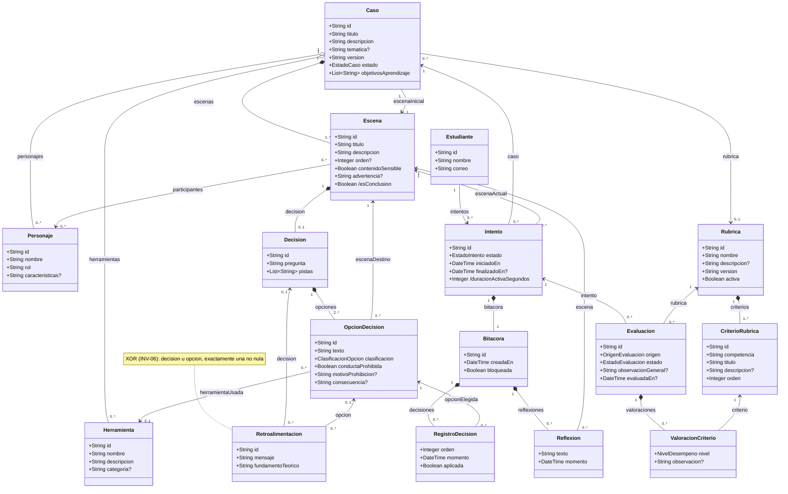

# Fase 1 — Modelado del dominio del simulador de casos situacionales

| | |
|---|---|
| **Taller** | Diseño de un DSL para la Gestión de Casos Situacionales del Simulador de Psicología Social |
| **Asignatura** | Ingeniería de Software II |
| **Equipo** | Juan José Sua Gómez y Emerson Ángel Gómez (fases 1, 3 y 4) |
| **Entregable** | 1 — Modelo UML de clases del dominio del simulador |
| **Archivos** | `modelo-dominio.mmd` (diagrama editable en Mermaid) y este documento |
| **Versión** | 10 de octubre de 2026 |

---

## 0. Qué contiene este documento y dónde está cada cosa

| Lo que pide la Fase 1 del enunciado | Dónde está |
|---|---|
| Diagrama UML de clases con Caso, Escena, Personaje, Decisión, OpciónDecisión, Herramienta, Retroalimentación, Bitácora y Evaluación | §2 y `modelo-dominio.mmd` |
| Para cada clase: atributos, relaciones, cardinalidades y responsabilidades | §3 (clases), §4 (enumeraciones), §5 (relaciones) |
| Al menos 3 reglas o invariantes del dominio | §6: 20 invariantes; INV-01 a INV-03 son los tres ejemplos del enunciado |
| Correspondencia con el simulador real (SIEP) | §7 |
| Decisiones de diseño y supuestos | §8 |

**El modelo en una frase.** Un `Caso` es un grafo de `Escena`s: cada escena puede presentar una `Decision` con dos o más `OpcionDecision`, y cada opción conduce a otra escena; una escena sin decisión es una conclusión. Cuando un `Estudiante` recorre el caso se crea un `Intento` con su `Bitacora` (decisiones registradas y reflexiones) y, al terminar, una `Evaluacion` formativa con la `Rubrica` del caso.

**Clases.** El diagrama tiene 16 clases:

- Las 9 que exige el enunciado: `Caso`, `Escena`, `Personaje`, `Decision`, `OpcionDecision`, `Herramienta`, `Retroalimentacion`, `Bitacora` y `Evaluacion`.
- 7 adicionales que el dominio justifica: `Estudiante`, `Intento`, `RegistroDecision`, `Reflexion`, `Rubrica`, `CriterioRubrica` y `ValoracionCriterio`.

**Nombres.** Los identificadores del modelo (clases, atributos, roles y valores de enumeraciones) van sin tildes ni eñes (`Decision`, `Bitacora`, `descripcion`) porque son los mismos que usará el JSON de la Fase 3. En el texto se escriben con ortografía normal.

**Numeración de las reglas OCL.** La Fase 2 formaliza las reglas en OCL numeradas OCL-01 a OCL-08 en el orden en que las lista el enunciado. Aquí, `INV-01` a `INV-08` son las mismas ocho reglas y en el mismo orden, de modo que `OCL-0n` formaliza `INV-0n`.

---

## 1. Alcance y fuentes

**Qué cubre el modelo.** Las dos mitades que necesita un DSL de casos situacionales:

1. **Definición del caso**: lo que escribe el docente (caso, escenas, personajes, decisiones, opciones, herramientas, retroalimentaciones y rúbrica).
2. **Registro de un intento**: lo que produce el estudiante al ejecutar el caso (intento, bitácora, decisiones registradas, reflexiones y evaluación). El enunciado lo pide en la Fase 3 como «bitácora o registro de decisiones».

**De dónde sale.**

| Fuente | Qué aporta |
|---|---|
| Enunciado del taller (Fase 1) | Clases mínimas, ejemplo de relaciones, tres invariantes de ejemplo |
| Línea base académica `docs/requisitos/baseline-pn3/RequisitosPN3.xlsx` | Requisitos RF-01 a RF-26 y reglas RN-01 a RN-11 |
| Código de SIEP (rama `docs/documento-maestro-unificado`, commit `46b7206`) | Cómo existen hoy los conceptos: modelos Django, validaciones y reglas del motor |

**Criterio cuando las fuentes difieren.** El modelo sigue la línea base y el enunciado. Cada diferencia con SIEP queda anotada en §7.4.

**Rutas de archivo.** Son relativas a la raíz del repositorio; `sim/` abrevia `backend_django/apps/simulation/`.

---

## 2. Diagrama UML de clases



**Cómo leerlo**

| Elemento | Significado |
|---|---|
| `*--` (rombo lleno) | Composición: la parte no existe sin el todo (`Caso` y sus `Escena`s) |
| `o--` (rombo vacío) | Agregación: el todo reúne partes con vida propia (`Caso` y sus `Personaje`s y `Herramienta`s) |
| `-->` / `<--` | Asociación con navegabilidad; la punta está en la clase referenciada |
| Rótulo sobre la línea | Nombre de rol en el extremo de la punta; es el nombre que se usa para navegar en OCL (`self.escenas`, `self.escenaDestino`) |
| `"1"`, `"0..1"`, `"0..*"`, `"1..*"`, `"2..*"` | Cardinalidad en cada extremo |
| `?` al final del atributo | Atributo opcional (0..1) |
| `/` al inicio del atributo | Atributo derivado: se calcula, no se escribe |
| Tipos `EstadoCaso`, `ClasificacionOpcion`, `EstadoIntento`, `OrigenEvaluacion`, `EstadoEvaluacion`, `NivelDesempeno` | Enumeraciones descritas en §4 |

**Dos bloques.** `Caso`, `Escena`, `Personaje`, `Decision`, `OpcionDecision`, `Herramienta`, `Retroalimentacion`, `Rubrica` y `CriterioRubrica` forman la *definición*. `Estudiante`, `Intento`, `Bitacora`, `RegistroDecision`, `Reflexion`, `Evaluacion` y `ValoracionCriterio` forman la *ejecución* y apuntan hacia la definición, nunca al revés: un caso no sabe quién lo ejecutó.

**Para ver el diagrama.** Pegue el contenido de `modelo-dominio.mmd` en <https://mermaid.live> o abra este archivo en una vista previa de Markdown que renderice Mermaid.

---

## 3. Descripción de las clases

Convenciones de las tablas: «Obligatorio» indica si el atributo debe tener valor; las listas obligatorias pueden estar vacías salvo que una invariante diga lo contrario. Los ejemplos salen del enunciado (`CASO-001`, Laura, Carlos, `H01 Mapa de actores`).

### 3.1 Caso

**Qué representa.** La unidad de contenido del simulador: una situación de psicología social completa, con su grafo de escenas, sus personajes, sus herramientas y su rúbrica. Es la unidad que se valida, se publica y se ejecuta.

| Atributo | Tipo | Obligatorio | Descripción |
|---|---|---|---|
| `id` | String | Sí | Identificador único y legible. Ejemplo: `CASO-001` |
| `titulo` | String | Sí | Nombre del caso (INV-07). Ejemplo: «Conflicto en una organización» |
| `descripcion` | String | Sí | Contexto de la situación (INV-07) |
| `tematica` | String | No | Área temática. Ejemplo: «Psicologia social» |
| `version` | String | Sí | Versión del caso (`1.0.0`). Un caso se publica por versiones |
| `estado` | EstadoCaso | Sí | `BORRADOR`, `PUBLICADO` o `ARCHIVADO` (RF-13) |
| `objetivosAprendizaje` | `List<String>` | No (0..*) | Objetivos que el estudiante ve antes de empezar (RF-16) |

**Relaciones.**

- Compone 1..* `Escena` (`escenas`) y designa exactamente una `escenaInicial`.
- Agrega 0..* `Personaje` (`personajes`) y 0..* `Herramienta` (`herramientas`).
- Se valora con 0..1 `Rubrica` (`rubrica`).
- Es ejecutado por 0..* `Intento`.

**Responsabilidades.**

- Reunir y dar identidad a todo el contenido de una situación.
- Conocer su escena inicial y sus puntos de decisión.
- Ser la unidad sobre la que se verifican las invariantes antes de publicar (INV-15).

### 3.2 Escena

**Qué representa.** Un momento de la situación en el que se encuentra el estudiante. Puede presentar una decisión o cerrar el caso.

| Atributo | Tipo | Obligatorio | Descripción |
|---|---|---|---|
| `id` | String | Sí | Identificador único en el caso (INV-13). Ejemplo: `E01` |
| `titulo` | String | Sí | Nombre breve de la escena |
| `descripcion` | String | Sí | Narración de lo que ocurre. Ejemplo: «El equipo presenta un conflicto durante una reunión» |
| `orden` | Integer | No | Posición para listar y ordenar las escenas (RF-06) |
| `contenidoSensible` | Boolean | Sí (por defecto `false`) | Marca contenido que exige cuidado con el estudiante |
| `advertencia` | String | No | Aviso que se muestra antes de un contenido sensible |
| `/esConclusion` | Boolean (derivado) | — | `true` cuando la escena no tiene decisión |

**Relaciones.**

- Pertenece a 1 `Caso` (rol inverso `caso`).
- Compone 0..1 `Decision` (`decision`).
- Tiene 0..* `Personaje` como `participantes`.
- Es destino de 0..* `OpcionDecision` (`escenaDestino`), escena actual de 0..* `Intento` y objeto de 0..* `Reflexion`.

**Responsabilidades.**

- Narrar la situación.
- Presentar su decisión si la tiene.
- Indicar si es una conclusión (cierre del recorrido).

### 3.3 Personaje

**Qué representa.** Una persona de la situación con características y rol determinados.

| Atributo | Tipo | Obligatorio | Descripción |
|---|---|---|---|
| `id` | String | Sí | Identificador único en el caso. Ejemplo: `P01` |
| `nombre` | String | Sí | Ejemplo: «Laura» |
| `rol` | String | Sí | Papel en la situación. Ejemplo: «Líder del equipo» |
| `caracteristicas` | String | No | Rasgos relevantes para el análisis |

**Relaciones.** Es agregado por 1 `Caso` (rol inverso `caso`); participa en 0..* `Escena`s.

**Responsabilidades.** Describir quién interviene en la situación y poder reutilizarse en varias escenas del caso.

### 3.4 Decision

**Qué representa.** El punto de decisión: la pregunta que el estudiante debe resolver en una escena.

| Atributo | Tipo | Obligatorio | Descripción |
|---|---|---|---|
| `id` | String | Sí | Identificador único en el caso (INV-04). Ejemplo: `D01` |
| `pregunta` | String | Sí | Ejemplo: «¿Qué debería hacer el estudiante inicialmente?» |
| `pistas` | `List<String>` | No (0..*) | Ayudas opcionales que el estudiante puede consultar (RF-11, RF-18) |

**Relaciones.**

- Pertenece a 1 `Escena` (rol inverso `escena`).
- Compone 2..* `OpcionDecision` (`opciones`).
- Puede tener 0..* `Retroalimentacion` asociadas.

**Responsabilidades.**

- Plantear el dilema.
- Agrupar las alternativas de intervención (mínimo dos, INV-02).
- Ofrecer ayudas al estudiante sin revelar la respuesta.

### 3.5 OpcionDecision

**Qué representa.** Una alternativa de intervención que el estudiante puede elegir; determina a qué escena continúa el caso.

| Atributo | Tipo | Obligatorio | Descripción |
|---|---|---|---|
| `id` | String | Sí | Identificador único en el caso (INV-13). Ejemplo: `OP01` |
| `texto` | String | Sí | Ejemplo: «Analizar los actores involucrados» |
| `clasificacion` | ClasificacionOpcion | Sí | `ADECUADA`, `RIESGOSA` o `INADECUADA`; base de la valoración formativa |
| `conductaProhibida` | Boolean | Sí (por defecto `false`) | `true` si la opción vulnera un principio ético de la intervención |
| `motivoProhibicion` | String | No | Razón de la prohibición; obligatoria si `conductaProhibida` es `true` (INV-12) |
| `consecuencia` | String | No | Efecto narrativo que el estudiante ve en el momento de elegir (RN-08) |

**Relaciones.**

- Pertenece a 1 `Decision` (rol inverso `decision`).
- Conduce a exactamente 1 `Escena` (`escenaDestino`).
- Usa 0..1 `Herramienta` (`herramientaUsada`).
- Puede tener 0..* `Retroalimentacion` asociadas.
- Es elegida en 0..* `RegistroDecision`.

**Responsabilidades.**

- Representar una alternativa y a dónde conduce (la ramificación).
- Declarar la herramienta que se emplea al elegirla.
- Declarar su consecuencia inmediata y su valoración pedagógica.

### 3.6 Herramienta

**Qué representa.** Un instrumento profesional que el estudiante puede emplear en el caso (mapa de actores, protocolo de comunicación, valoración de riesgo).

| Atributo | Tipo | Obligatorio | Descripción |
|---|---|---|---|
| `id` | String | Sí | Identificador único en el caso. Ejemplo: `H01` |
| `nombre` | String | Sí | Ejemplo: «Mapa de actores» |
| `descripcion` | String | Sí | Ejemplo: «Herramienta para identificar actores e intereses» |
| `categoria` | String | No | Agrupación libre (crisis, comunicación, evaluación, protección, reflexión) |

**Relaciones.** Es agregada por 1 `Caso` (rol inverso `caso`); la usan 0..* `OpcionDecision`.

**Responsabilidades.** Describir el instrumento y estar disponible solo si el caso la define (INV-05).

### 3.7 Retroalimentacion

**Qué representa.** La explicación pedagógica, con su fundamento teórico, de por qué una decisión o una opción es adecuada o no. Se presenta al terminar el intento (RN-08, RF-23), a diferencia de la consecuencia, que se ve en el momento.

| Atributo | Tipo | Obligatorio | Descripción |
|---|---|---|---|
| `id` | String | Sí | Identificador único en el caso |
| `mensaje` | String | Sí | Explicación para el estudiante |
| `fundamentoTeorico` | String | Sí | Marco o autor que respalda el mensaje (RF-10). Ejemplo: «Psicologia social» |

**Relaciones.** Se asocia a `Decision` (`decision`, 0..1) **o** a `OpcionDecision` (`opcion`, 0..1): exactamente una de las dos (INV-06). Desde `Decision` y `OpcionDecision` se ve como 0..* retroalimentaciones.

**Responsabilidades.** Explicar la elección, citar el fundamento teórico y mostrarse solo al cerrar el intento.

### 3.8 Rubrica

**Qué representa.** El conjunto de criterios formativos con que se valora el desempeño del estudiante en un caso (RF-22).

| Atributo | Tipo | Obligatorio | Descripción |
|---|---|---|---|
| `id` | String | Sí | Identificador único |
| `nombre` | String | Sí | Ejemplo: «Rúbrica formativa de intervención» |
| `descripcion` | String | No | Qué evalúa en conjunto |
| `version` | String | Sí | Versión de la rúbrica |
| `activa` | Boolean | Sí | Solo una rúbrica activa se puede aplicar |

**Relaciones.** Compone 1..* `CriterioRubrica` (`criterios`); se asigna a 0..* `Caso`s; la aplican 0..* `Evaluacion`es.

**Responsabilidades.** Definir qué se valora y con qué criterios.

### 3.9 CriterioRubrica

**Qué representa.** Un aspecto o competencia que se observa en el desempeño.

| Atributo | Tipo | Obligatorio | Descripción |
|---|---|---|---|
| `id` | String | Sí | Identificador único |
| `competencia` | String | Sí | Competencia que se observa. Ejemplo: `CONTENCION` |
| `titulo` | String | Sí | Ejemplo: «Contención emocional y manejo de crisis» |
| `descripcion` | String | No | Qué se espera ver |
| `orden` | Integer | Sí | Posición dentro de la rúbrica |

**Relaciones.** Pertenece a 1 `Rubrica` (rol inverso `rubrica`); lo valoran 0..* `ValoracionCriterio`.

**Responsabilidades.** Nombrar y describir lo que se observa.

### 3.10 Estudiante

**Qué representa.** La persona que ejecuta los casos y escribe su bitácora.

| Atributo | Tipo | Obligatorio | Descripción |
|---|---|---|---|
| `id` | String | Sí | Identificador único |
| `nombre` | String | Sí | Nombre completo |
| `correo` | String | Sí | Correo institucional |

**Relaciones.** Realiza 0..* `Intento`s (`intentos`).

**Responsabilidades.** Ser el actor de la ejecución y el titular de su historial de intentos (RF-24).

### 3.11 Intento

**Qué representa.** El recorrido de un estudiante por un caso, de la escena inicial a una conclusión. Cada repetición es un intento nuevo e independiente (RN-06, RN-07).

| Atributo | Tipo | Obligatorio | Descripción |
|---|---|---|---|
| `id` | String | Sí | Identificador único |
| `estado` | EstadoIntento | Sí | `EN_CURSO`, `PAUSADO`, `COMPLETADO` o `REEMPLAZADO` (§4) |
| `iniciadoEn` | DateTime | Sí | Momento de inicio |
| `finalizadoEn` | DateTime | No | Vacío mientras el intento esté abierto |
| `/duracionActivaSegundos` | Integer (derivado) | — | Tiempo efectivamente utilizado, calculado a partir de los registros (RF-21) |

**Relaciones.**

- Lo realiza 1 `Estudiante`; ejecuta 1 `Caso` (`caso`); está en 1 `Escena` (`escenaActual`).
- Compone 1 `Bitacora` (`bitacora`).
- Lo valoran 0..* `Evaluacion`es.

**Responsabilidades.**

- Conservar el avance para continuar desde el último punto (RF-19).
- Conservar el recorrido y el tiempo (RF-21).
- Cerrarse al llegar a una conclusión (RF-22).

### 3.12 Bitacora

**Qué representa.** El registro del intento: las decisiones que tomó el estudiante y las reflexiones que escribió. Es el «registro de decisiones» que pide la Fase 3.

| Atributo | Tipo | Obligatorio | Descripción |
|---|---|---|---|
| `id` | String | Sí | Identificador único |
| `creadaEn` | DateTime | Sí | Momento de creación |
| `bloqueada` | Boolean | Sí | `true` cuando el intento terminó o fue reemplazado (INV-19) |

**Relaciones.** Pertenece a 1 `Intento` (rol inverso `intento`); compone 0..* `RegistroDecision` (`decisiones`) y 0..* `Reflexion` (`reflexiones`).

**Responsabilidades.**

- Trazar el recorrido del intento.
- Recibir reflexiones mientras el intento está en juego.
- Bloquearse al cerrarse el intento.

### 3.13 RegistroDecision

**Qué representa.** La constancia de una opción elegida durante el intento.

| Atributo | Tipo | Obligatorio | Descripción |
|---|---|---|---|
| `orden` | Integer | Sí | Posición en el recorrido |
| `momento` | DateTime | Sí | Cuándo se eligió |
| `aplicada` | Boolean | Sí (por defecto `true`) | `false` si la elección quedó registrada pero no hizo avanzar el caso (primera respuesta riesgosa o inadecuada de una escena, que el simulador pide reconsiderar) |

**Relaciones.** Pertenece a 1 `Bitacora` (rol inverso `bitacora`); referencia 1 `OpcionDecision` (`opcionElegida`).

**Responsabilidades.** Conservar qué se eligió, cuándo y en qué orden, para reconstruir el recorrido y generar reportes.

### 3.14 Reflexion

**Qué representa.** La nota del estudiante donde justifica o analiza lo que decidió en una escena (RF-20).

| Atributo | Tipo | Obligatorio | Descripción |
|---|---|---|---|
| `texto` | String | Sí | Contenido de la reflexión; no puede ser vacío (INV-17) |
| `momento` | DateTime | Sí | Cuándo se guardó por última vez |

**Relaciones.** Pertenece a 1 `Bitacora` (rol inverso `bitacora`); se refiere a 1 `Escena` (`escena`).

**Responsabilidades.** Guardar la justificación del estudiante, editable mientras el intento esté en juego.

### 3.15 Evaluacion

**Qué representa.** La valoración formativa de un intento con la rúbrica del caso. **No produce una nota oficial de 0,0 a 5,0** (RN-09).

| Atributo | Tipo | Obligatorio | Descripción |
|---|---|---|---|
| `id` | String | Sí | Identificador único |
| `origen` | OrigenEvaluacion | Sí | `SISTEMA` (valoración automática al cerrar, RF-22) o `DOCENTE` (revisión del profesor, RF-25) |
| `estado` | EstadoEvaluacion | Sí | `PENDIENTE` o `EVALUADA` |
| `observacionGeneral` | String | No | Comentario global sobre el desempeño |
| `evaluadaEn` | DateTime | No | Cuándo se completó |

**Relaciones.** Valora 1 `Intento` (`intento`); aplica 1 `Rubrica` (`rubrica`); compone 0..* `ValoracionCriterio` (`valoraciones`).

**Responsabilidades.** Reunir el resultado cualitativo del intento por criterio, sin calcular una calificación numérica.

### 3.16 ValoracionCriterio

**Qué representa.** El nivel de desempeño que alcanzó el estudiante en un criterio de la rúbrica, con su observación.

| Atributo | Tipo | Obligatorio | Descripción |
|---|---|---|---|
| `nivel` | NivelDesempeno | Sí | `EN_INICIO`, `EN_PROCESO`, `LOGRADO` o `DESTACADO` |
| `observacion` | String | No | Justificación del nivel |

**Relaciones.** Pertenece a 1 `Evaluacion` (rol inverso `evaluacion`); valora 1 `CriterioRubrica` (`criterio`).

**Responsabilidades.** Registrar el resultado de un criterio.

---

## 4. Enumeraciones y estados

| Enumeración | Valores | Se usa en | Equivalente en SIEP |
|---|---|---|---|
| `EstadoCaso` | `BORRADOR`, `PUBLICADO`, `ARCHIVADO` | `Caso.estado` | `DRAFT`, `PUBLISHED`, `ARCHIVED`; SIEP define además `IN_REVIEW`, que ninguna ruta asigna |
| `ClasificacionOpcion` | `ADECUADA`, `RIESGOSA`, `INADECUADA` | `OpcionDecision.clasificacion` | `ADEQUATE`, `RISKY`, `INADEQUATE` |
| `EstadoIntento` | `EN_CURSO`, `PAUSADO`, `COMPLETADO`, `REEMPLAZADO` | `Intento.estado` | `IN_PROGRESS`, `PAUSED`, `COMPLETED`, `REPLACED`; SIEP conserva `SAFE_EXITED` solo en intentos históricos |
| `OrigenEvaluacion` | `SISTEMA`, `DOCENTE` | `Evaluacion.origen` | Sin equivalente: SIEP solo guarda la evaluación del docente |
| `EstadoEvaluacion` | `PENDIENTE`, `EVALUADA` | `Evaluacion.estado` | `PENDING`, `EVALUATED` |
| `NivelDesempeno` | `EN_INICIO`, `EN_PROCESO`, `LOGRADO`, `DESTACADO` | `ValoracionCriterio.nivel` | Sin equivalente: SIEP puntúa cada criterio de 1,0 a 5,0 |

**Transiciones de `EstadoIntento`** (las mismas que impone SIEP en `sim/services/attempt_lifecycle.py:13-21`):

| Desde | Acción | Hasta |
|---|---|---|
| `EN_CURSO` | llegar a una conclusión | `COMPLETADO` |
| `EN_CURSO` | pausar (salida segura) | `PAUSADO` |
| `PAUSADO` | reanudar | `EN_CURSO` |
| `EN_CURSO` o `PAUSADO` | iniciar un intento nuevo reemplazando | `REEMPLAZADO` |

`COMPLETADO` y `REEMPLAZADO` son terminales: un intento cerrado nunca se reabre.

**Estados de `Caso`.** `BORRADOR` → `PUBLICADO` → `ARCHIVADO`. Solo un caso `PUBLICADO` se puede ejecutar (RN-03) y solo se publica si cumple las invariantes (RN-05, INV-15).

---

## 5. Relaciones y cardinalidades en lenguaje natural

La columna «Rol» es el nombre que se usa para navegar desde la clase de origen; «Rol inverso» permite navegar de vuelta (útil para escribir OCL).

| N.º | Origen → destino | Tipo | Cardinalidad | Rol | Rol inverso | En lenguaje natural |
|---|---|---|---|---|---|---|
| R-01 | Caso → Escena | Composición | 1 → 1..* | `escenas` | `caso` | Un caso se compone de una o varias escenas; una escena pertenece a un solo caso y no existe sin él. |
| R-02 | Caso → Escena | Asociación | 1 → 1 | `escenaInicial` | — | Todo caso designa exactamente una escena inicial, que debe ser una de sus escenas (INV-09). |
| R-03 | Caso → Personaje | Agregación | 1 → 0..* | `personajes` | `caso` | Un caso reúne cero o más personajes que se reutilizan en sus escenas. |
| R-04 | Caso → Herramienta | Agregación | 1 → 0..* | `herramientas` | `caso` | Un caso define su catálogo de herramientas profesionales; solo estas pueden usarse en él (INV-05). |
| R-05 | Caso → Rubrica | Asociación | 0..* → 0..1 | `rubrica` | — | Un caso se valora con a lo sumo una rúbrica; una rúbrica puede servir a varios casos. |
| R-06 | Escena → Personaje | Asociación | 0..* ↔ 0..* | `participantes` | — | En una escena participan cero o más personajes del caso y un personaje puede aparecer en varias escenas (INV-14). |
| R-07 | Escena → Decision | Composición | 1 → 0..1 | `decision` | `escena` | Una escena presenta como máximo una decisión; una escena sin decisión es una conclusión. |
| R-08 | Decision → OpcionDecision | Composición | 1 → 2..* | `opciones` | `decision` | Una decisión se compone de al menos dos opciones (INV-02). |
| R-09 | OpcionDecision → Escena | Asociación | 0..* → 1 | `escenaDestino` | — | Cada opción conduce a exactamente una escena del caso; a una escena pueden llegar varias opciones (INV-03). |
| R-10 | OpcionDecision → Herramienta | Asociación | 0..* → 0..1 | `herramientaUsada` | — | Una opción puede indicar la herramienta que se emplea al elegirla; una herramienta puede usarse en varias opciones. |
| R-11 | Retroalimentacion → Decision | Asociación | 0..* → 0..1 | `decision` | `retroalimentaciones` | Una retroalimentación puede estar asociada a una decisión. |
| R-12 | Retroalimentacion → OpcionDecision | Asociación | 0..* → 0..1 | `opcion` | `retroalimentaciones` | Una retroalimentación puede estar asociada a una opción. Entre R-11 y R-12 debe haber exactamente una (INV-06). |
| R-13 | Rubrica → CriterioRubrica | Composición | 1 → 1..* | `criterios` | `rubrica` | Una rúbrica se compone de uno o más criterios. |
| R-14 | Estudiante → Intento | Asociación | 1 → 0..* | `intentos` | `estudiante` | Un estudiante realiza cero o más intentos; cada intento es de un solo estudiante. |
| R-15 | Intento → Caso | Asociación | 0..* → 1 | `caso` | — | Cada intento recorre exactamente un caso; un caso puede tener muchos intentos. |
| R-16 | Intento → Escena | Asociación | 0..* → 1 | `escenaActual` | — | Cada intento está en una escena en cada momento; allí se reanuda. |
| R-17 | Intento → Bitacora | Composición | 1 → 1 | `bitacora` | `intento` | Cada intento tiene exactamente una bitácora, que no existe sin él. |
| R-18 | Bitacora → RegistroDecision | Composición | 1 → 0..* | `decisiones` | `bitacora` | La bitácora registra cero o más decisiones tomadas. |
| R-19 | Bitacora → Reflexion | Composición | 1 → 0..* | `reflexiones` | `bitacora` | La bitácora contiene cero o más reflexiones del estudiante. |
| R-20 | RegistroDecision → OpcionDecision | Asociación | 0..* → 1 | `opcionElegida` | — | Cada registro se refiere a la opción que se eligió (INV-18). |
| R-21 | Reflexion → Escena | Asociación | 0..* → 1 | `escena` | — | Cada reflexión se refiere a la escena en que se escribió. |
| R-22 | Evaluacion → Intento | Asociación | 0..* → 1 | `intento` | `evaluaciones` | Cada evaluación valora un intento; un intento puede tener varias (la del sistema y la del docente). |
| R-23 | Evaluacion → Rubrica | Asociación | 0..* → 1 | `rubrica` | — | Cada evaluación aplica exactamente una rúbrica. |
| R-24 | Evaluacion → ValoracionCriterio | Composición | 1 → 0..* | `valoraciones` | `evaluacion` | Una evaluación se compone de las valoraciones de sus criterios; está `PENDIENTE` mientras falten (INV-20). |
| R-25 | ValoracionCriterio → CriterioRubrica | Asociación | 0..* → 1 | `criterio` | — | Cada valoración se refiere a un criterio de la rúbrica de su evaluación. |

---

## 6. Invariantes del dominio

### 6.1 Resumen

El grupo A son las ocho reglas que el enunciado propone para la Fase 2 (INV-01 a INV-03 son además los tres ejemplos de la Fase 1). El grupo B son reglas estructurales que el dominio de SIEP justifica. El grupo C cubre la ejecución y la valoración. La última columna dice si SIEP ya valida la regla, con la referencia al código.

| ID | Invariante | Contexto | Origen | Regla OCL | ¿La valida SIEP hoy? |
|---|---|---|---|---|---|
| **A. Reglas del enunciado** | | | | | |
| INV-01 | Un caso contiene al menos una escena | Caso | Enunciado (ejemplo); RF-06 | OCL-01 | **Sí**: `NO_NODES` (`sim/services/world_validation.py:53-55`) |
| INV-02 | Una decisión tiene como mínimo dos opciones | Decision | Enunciado (ejemplo); RF-08; RN-11 | OCL-02 | **No**: SIEP no revisa los nodos sin opciones ni con una sola |
| INV-03 | Toda opción conduce a una escena que existe y pertenece al mismo caso | OpcionDecision | Enunciado (ejemplo); RF-09; RN-02 | OCL-03 | **Parcial**: el destino es obligatorio (`sim/models/case.py:107-110`) pero no se comprueba que sea de la misma versión (`sim/services/authoring/graph.py:87-92`) |
| INV-04 | Los identificadores de decisión no se repiten (en la escena ni en el caso) | Caso | Enunciado (Fase 2) | OCL-04 | **Parcial**: SIEP no tiene identificador de decisión; la clave de opción es única por versión solo en el volcado de despliegue (`deploy/db_seed.sql:3575`) |
| INV-05 | Toda herramienta usada por una opción está definida en el caso | OpcionDecision | Enunciado (Fase 2) | OCL-05 | **Parcial**: en ejecución `use_tool` exige que exista en la versión (`sim/services/world_service.py:271-275`); al autorar no se comprueba |
| INV-06 | Toda retroalimentación está asociada a exactamente una decisión o una opción | Retroalimentacion | Enunciado (Fase 2); RF-10 | OCL-06 | **Por construcción**: el texto es un campo de la opción (`sim/models/case.py:116`); no existe a nivel de decisión |
| INV-07 | Todo caso tiene título y descripción no vacíos | Caso | Enunciado (Fase 2) | OCL-07 | **Parcial**: exige título al crear (`sim/services/authoring/cases.py:36-38`); la descripción puede ir vacía |
| INV-08 | Todo caso contiene al menos un punto de decisión | Caso | Enunciado (Fase 2); RF-08 | OCL-08 | **No**: un caso con un solo nodo, inicial y terminal, pasa la validación del grafo (`sim/services/world_validation.py:52-76`) |
| **B. Reglas estructurales adicionales** | | | | | |
| INV-09 | Un caso tiene exactamente una escena inicial y es una de sus escenas | Caso | RF-17; SIEP | — | **Sí**: `NO_START_NODE`, `MULTIPLE_START_NODES` (`sim/services/world_validation.py:57-67`) |
| INV-10 | El flujo es acíclico: ninguna secuencia de opciones vuelve a una escena ya recorrida | Escena | SIEP | — | **Sí**: `GRAPH_CYCLE` (`sim/services/world_validation.py:79-104`) |
| INV-11 | Toda escena es alcanzable desde la inicial | Caso | Propuesta de este modelo | — | **No**: no se revisan nodos inalcanzables; el caso sembrado tiene un nodo-sala al que ninguna opción conduce (`sim/management/commands/seed_caso_pdf.py:216-224`) |
| INV-12 | Una opción marcada como conducta prohibida documenta el motivo | OpcionDecision | SIEP (ética); RN-01 | — | **Sí**: `PROHIBITED_WITHOUT_REASON` (`sim/services/world_validation.py:144-152`) |
| INV-13 | Los identificadores de escenas, personajes, herramientas, decisiones y opciones no se repiten dentro del caso | Caso | SIEP; necesario para referenciar en JSON | — | **Parcial**: únicos por versión solo en el volcado (`deploy/db_seed.sql:3903,3575,3527`) |
| INV-14 | Los personajes que participan en una escena pertenecen al caso | Escena | RF-07 | — | **No aplica**: en SIEP el personaje es un objeto de la sala |
| INV-15 | Un caso PUBLICADO cumple INV-01 a INV-14 y su contenido no se edita: los cambios van en una versión nueva | Caso | RN-03; RN-05; RF-12; RF-13 | — | **Parcial**: publicar exige checklist al 100 % y cero errores de validación (`sim/services/authoring/publication.py:68-80`); solo se edita un borrador (`sim/services/authoring/guards.py:28-36`) |
| **C. Ejecución y valoración** | | | | | |
| INV-16 | Un estudiante no tiene dos intentos abiertos (`EN_CURSO` o `PAUSADO`) del mismo caso | Estudiante | RN-06; RN-07 | — | **Parcial**: lo resuelve la lógica de `start_attempt` (`sim/services/game_service.py:166-179`); sin restricción en la base de datos |
| INV-17 | La bitácora tiene a lo sumo una reflexión por escena y su texto no es vacío | Bitacora | RF-20 | — | **Sí**: UNIQUE (intento, nodo) (`deploy/db_seed.sql:3783`); texto no vacío (`sim/services/game_service.py:430-431`) |
| INV-18 | Toda decisión registrada corresponde a una opción del caso del intento | RegistroDecision | RF-21 | — | **Sí**: `sim/services/game_service.py:354-357` |
| INV-19 | La bitácora se bloquea cuando el intento termina o es reemplazado, y no antes | Bitacora | RN-06 | — | **Sí**: `sim/services/game_service.py:52-55,142-157,406-411` |
| INV-20 | Una evaluación solo valora criterios de la rúbrica del caso; está `EVALUADA` solo si cubre todos; no existe nota numérica oficial | Evaluacion | RF-22; RN-09 | — | **Parcial**: el estado `EVALUATED` exige todos los criterios (`sim/services/rubric_service.py:430`); pero SIEP calcula un `total_score` ponderado sobre 1,0 a 5,0 (`sim/services/rubric_service.py:418-430`), tensión con RN-09 que el equipo debe resolver |

**Nota sobre INV-04.** Como una escena presenta como máximo una decisión (R-07), «dos decisiones con el mismo identificador en una escena» es imposible por la propia cardinalidad. La regla conserva su sentido a nivel de caso: la retroalimentación y los registros citan las decisiones por su identificador, así que no puede repetirse en ninguna escena.

**Regla de presentación RP-01 (no estructural).** La consecuencia de una opción (`OpcionDecision.consecuencia` y la escena destino) se presenta en el momento de elegir, para poder continuar la historia. La `Retroalimentacion` pedagógica se presenta solo cuando el intento termina (`COMPLETADO`). Origen: RN-08, RF-10, RF-23.

### 6.2 Expresión de apoyo en OCL

Son esbozos que usan los nombres de rol del §5. La redacción definitiva, la explicación y los ejemplos de cada regla son de la Fase 2 (INV-01 a INV-08 ↔ OCL-01 a OCL-08).

```ocl
-- Atributo derivado
context Escena::esConclusion : Boolean
derive: self.decision->isEmpty()

-- A. Reglas del enunciado
context Caso
inv INV01: self.escenas->size() >= 1

context Decision
inv INV02: self.opciones->size() >= 2

context OpcionDecision
inv INV03: self.decision.escena.caso.escenas->includes(self.escenaDestino)

context Caso
inv INV04: self.escenas.decision->isUnique(id)

context OpcionDecision
inv INV05: self.herramientaUsada->notEmpty() implies
    self.decision.escena.caso.herramientas->includes(self.herramientaUsada)

context Retroalimentacion
inv INV06: self.decision->notEmpty() xor self.opcion->notEmpty()

context Caso
inv INV07: self.titulo.size() > 0 and self.descripcion.size() > 0

context Caso
inv INV08: self.escenas.decision->notEmpty()

-- B. Reglas estructurales adicionales
context Caso
inv INV09: self.escenas->includes(self.escenaInicial)

context Escena
inv INV10: not self.decision.opciones.escenaDestino
    ->closure(e | e.decision.opciones.escenaDestino)->includes(self)

context Caso
inv INV11: self.escenas->forAll(e | e = self.escenaInicial or
    self.escenaInicial.decision.opciones.escenaDestino
        ->closure(x | x.decision.opciones.escenaDestino)->includes(e))

context OpcionDecision
inv INV12: self.conductaProhibida implies
    (not self.motivoProhibicion.oclIsUndefined() and self.motivoProhibicion.size() > 0)

context Caso
inv INV13: self.escenas->isUnique(id) and self.personajes->isUnique(id)
    and self.herramientas->isUnique(id)
    and self.escenas.decision->isUnique(id)
    and self.escenas.decision.opciones->isUnique(id)

context Escena
inv INV14: self.caso.personajes->includesAll(self.participantes)

-- INV-15 no agrega una expresión nueva: es la precondición de publicar
context Caso::publicar()
pre: self.estado = EstadoCaso::BORRADOR   -- y se cumplen INV01 a INV14

-- C. Ejecución y valoración
context Estudiante
inv INV16: self.intentos
    ->select(estado = EstadoIntento::EN_CURSO or estado = EstadoIntento::PAUSADO)
    ->isUnique(caso)

context Bitacora
inv INV17: self.reflexiones->isUnique(escena)
    and self.reflexiones->forAll(r | r.texto.size() > 0)

context RegistroDecision
inv INV18: self.opcionElegida.decision.escena.caso = self.bitacora.intento.caso

context Bitacora
inv INV19: self.bloqueada = (self.intento.estado = EstadoIntento::COMPLETADO
    or self.intento.estado = EstadoIntento::REEMPLAZADO)

context Evaluacion
inv INV20a: self.valoraciones->forAll(v | self.rubrica.criterios->includes(v.criterio))
inv INV20b: self.estado = EstadoEvaluacion::EVALUADA implies
    self.valoraciones->size() = self.rubrica.criterios->size()
-- INV20c: ninguna clase del modelo tiene un atributo de nota numerica; se cumple por estructura
```

---

## 7. Correspondencia con SIEP

SIEP es el simulador real del que sale el dominio. Hoy **no tiene un DSL, ni un JSON Schema, ni importación o exportación de casos**: los casos se definen mediante el editor de administración y un comando de siembra en Python (`sim/management/commands/seed_caso_pdf.py`). El modelo de este documento es la capa que le falta. Las rutas siguen la convención del §1 (`sim/` abrevia `backend_django/apps/simulation/`).

### 7.1 Clase por clase

| Clase del modelo | Concepto real en SIEP | Modelo Django / tabla / campo | Archivo | Cobertura |
|---|---|---|---|---|
| `Caso` | Caso + versión del caso | `SimulationCase` (`simulation_cases`: `code`, `title`, `description`, `active`) + `CaseVersion` (`case_versions`: `semantic_version`, `status`, `narrative_context`, `published_at`) | `sim/models/case.py:23-71` | Parcial: dos tablas se aplanan en una clase; SIEP no tiene temática ni objetivos de aprendizaje |
| `Escena` | Nodo del grafo + sala | `SimulationNode` (`simulation_nodes`: `node_key`, `title`, `narrative`, `sensitive_content`, `warning_message`, `start_node`, `terminal_node`) + `SceneMap` (`scene_maps`) | `sim/models/case.py:74-96`; `sim/models/world.py:11-29` | Parcial: SIEP une narrativa y espacio; el modelo toma solo la narrativa |
| `Personaje` | Objeto de tipo `PERSON` del mapa de una sala (NPC) y su diálogo | `MapObject` con `object_type='PERSON'`; `DialogueTree.speaker_name` | `sim/models/world.py:32-65,84-99`; `deploy/db_seed.sql:979`; plantilla en `frontend/src/app/features/simulator/authoring-catalog.config.ts:57-71` | Sin clase propia; SIEP no tiene rol ni características |
| `Decision` | Grupo de opciones que salen del mismo nodo | No hay tabla: son los `DecisionOption` con el mismo `source_node` | `sim/models/case.py:99-125`; `sim/services/authoring/editor_view.py:23-28,91-107`; `sim/serializers/game_dtos.py:57-64` | Implícita |
| `OpcionDecision` | Opción de decisión (arista del grafo) | `DecisionOption` (`decision_options`: `option_key`, `text`, `classification`, `prohibited_conduct`, `prohibition_reason`, `immediate_feedback`, `target_node`) | `sim/models/case.py:99-125`; `sim/services/authoring/graph.py:86-110` | Directa |
| `Herramienta` | Herramienta clínica de la versión | `ClinicalTool` (`clinical_tools`: `tool_code`, `label`, `description`, `category`) | `sim/models/world.py:137-151`; `sim/services/authoring/tools.py:36-42` | Directa en el catálogo; el uso no cuelga de una opción |
| `Retroalimentacion` | Texto de retroalimentación de la opción | Campo `DecisionOption.immediate_feedback` (+ `prohibition_reason`) | `sim/models/case.py:116-118`; `sim/services/decision_effects.py:72-80` | Sin clase: no hay fundamento teórico estructurado ni retroalimentación a nivel de decisión |
| `Rubrica` | Rúbrica y su asignación a la versión | `Rubric` (`rubrics`) + `SimulationRubricAssignment` | `sim/models/rubric.py:9-28,88-103`; `sim/services/rubric_service.py:297-311` | Directa |
| `CriterioRubrica` | Criterio de la rúbrica | `RubricCriterion` (`competency`, `title`, `description`, `weight`, `display_order`) | `sim/models/rubric.py:31-46` | Directa (SIEP añade peso) |
| `Estudiante` | Usuario con rol `ESTUDIANTE` | `CustomUser` (`users`: `nombre`, `apellido`, `email`, `role`) | `backend_django/apps/users/models.py:18-21,41-67` | Directa |
| `Intento` | Intento | `SimulationAttempt` (`simulation_attempts_v2`: `status`, `current_node`, `started_at`, `ended_at`) | `sim/models/attempt.py:15-67`; `sim/services/attempt_lifecycle.py:13-21,64-81` | Directa; SIEP añade métricas del intento |
| `Bitacora` | No hay entidad: es el conjunto de reflexiones y eventos de un intento | `ReflectionJournal` + `AttemptEvent` del intento | `sim/models/attempt.py:70-107` | Sin clase |
| `RegistroDecision` | Evento del intento | `AttemptEvent` con `event_type` `DECISION_SELECTED`, `PROHIBITED_DECISION_SELECTED` o `*_RETRY_REQUIRED` (no aplicada) | `sim/models/attempt.py:70-90`; `sim/services/game_service.py:359-422` | Parcial: un subconjunto de los tipos de evento |
| `Reflexion` | Nota reflexiva por (intento, nodo), cifrada | `ReflectionJournal` (`reflection_journals`: `encrypted_text`, `locked`) | `sim/models/attempt.py:93-107`; `sim/services/game_service.py:425-449`; `deploy/db_seed.sql:3783` | Directa |
| `Evaluacion` | Evaluación por rúbrica de un intento, hecha por un docente | `RubricEvaluation` (`rubric_evaluations`: `total_score`, `comment`, `status`) | `sim/models/rubric.py:49-68`; `sim/services/rubric_service.py:401-461` | Estructura directa; SIEP guarda un total ponderado y el modelo no |
| `ValoracionCriterio` | Puntaje de un criterio | `CriterionScore` (`criterion_scores`: `score`, `comment`) | `sim/models/rubric.py:71-85` | Directa (SIEP usa 1,0 a 5,0) |

### 7.2 Equivalencia de campos de la definición

Sirve de base para importar y exportar casos entre el DSL y SIEP (Fase 3).

| Modelo | Campo en SIEP | Observación |
|---|---|---|
| `Caso.id` | `SimulationCase.code` | |
| `Caso.titulo` | `SimulationCase.title` | |
| `Caso.descripcion` | `SimulationCase.description` y `CaseVersion.narrative_context` | Al crear un caso, SIEP copia la descripción al contexto narrativo (`sim/services/authoring/cases.py:55-61`) |
| `Caso.version` | `CaseVersion.semantic_version` | |
| `Caso.estado` | `CaseVersion.status` | `IN_REVIEW` no se asigna nunca |
| `Escena.id` | `SimulationNode.node_key` | |
| `Escena.titulo` | `SimulationNode.title` | |
| `Escena.descripcion` | `SimulationNode.narrative` | |
| `Escena.contenidoSensible` | `SimulationNode.sensitive_content` | Solo viaja al cliente; el servidor no lo aplica |
| `Escena.advertencia` | `SimulationNode.warning_message` | Ídem |
| `Caso.escenaInicial` | `SimulationNode.start_node = true` | |
| `Escena./esConclusion` | `SimulationNode.terminal_node` | En SIEP es una bandera independiente de las opciones |
| `Decision.pistas` | `SimulationNode.support_resources_json` | En SIEP las ayudas son del nodo, no de una decisión |
| `Decision.pregunta` | — | SIEP no tiene pregunta de decisión |
| `OpcionDecision.id` | `DecisionOption.option_key` | |
| `OpcionDecision.texto` | `DecisionOption.text` | |
| `OpcionDecision.escenaDestino` | `DecisionOption.target_node` | |
| `OpcionDecision.clasificacion` | `DecisionOption.classification` | |
| `OpcionDecision.conductaProhibida` / `motivoProhibicion` | `prohibited_conduct` / `prohibition_reason` | |
| `OpcionDecision.consecuencia` y `Retroalimentacion.mensaje` | `DecisionOption.immediate_feedback` | Un solo campo cumple los dos papeles (§7.4) |
| `Herramienta.id` / `nombre` / `descripcion` / `categoria` | `ClinicalTool.tool_code` / `label` / `description` / `category` | |
| `Personaje.nombre` | `MapObject.label` (objeto `PERSON`) | |
| `Personaje.rol`, `caracteristicas` | — | No existen en SIEP |

### 7.3 Lo que SIEP no modela como clase

Nota honesta: varios conceptos del enunciado existen en SIEP, pero **no como clase**, y el modelo los separa porque el DSL los necesita con identidad propia.

| Concepto del modelo | Cómo existe hoy en SIEP |
|---|---|
| **Escena** | Es un nodo del grafo (`SimulationNode`) **más** una sala (`SceneMap`) con objetos, colisiones y diálogos. El modelo toma solo el nodo narrativo. Además, SIEP tiene nodos-sala sin decisiones propias, solo para navegación espacial (`comisaria-recepcion`, `sim/management/commands/seed_caso_pdf.py:216-224`), que el DSL no representa. |
| **Personaje** | Es un objeto de tipo `PERSON` del mapa de una sala. No tiene identidad a nivel de caso ni rol: el mismo personaje en dos salas son dos objetos. |
| **Decision** | No existe. Es el conjunto de `DecisionOption` que comparten nodo de origen; no tiene identificador, pregunta ni retroalimentación propia. |
| **Retroalimentacion** | Es un texto libre (`immediate_feedback`) dentro de la opción. No hay campo de fundamento teórico ni de pista por opción; el fundamento va dentro del texto (`sim/management/commands/seed_caso_pdf.py:248-251`). |
| **Bitacora** | No hay entidad. Son filas sueltas de `ReflectionJournal` (una por intento y nodo) y de `AttemptEvent`. |
| **RegistroDecision** | Es un tipo de evento de la tabla `attempt_events`, mezclado con movimientos y herramientas. |
| **Consecuencia** | No existe como concepto. Lo más cercano es la narrativa del nodo destino más el efecto en los indicadores del intento. |
| **Conclusión** | Es la bandera `terminal_node` del nodo, que el autor marca a mano. |
| **Caso** | Son dos tablas: el caso y sus versiones; un intento apunta a una versión, no al caso. |

### 7.4 Diferencias entre SIEP y la línea base

El modelo sigue la línea base. En estos puntos SIEP hoy se comporta distinto:

| Tema | Línea base | SIEP hoy | Qué hace el modelo |
|---|---|---|---|
| Momento de la retroalimentación | RN-08, RF-10, RF-23: la pedagógica al terminar el intento; la consecuencia, en el momento | El texto `immediate_feedback` llega en la respuesta de la misma decisión (`sim/services/game_service.py:393,421`); el reporte de cierre no lo repite (`sim/serializers/game_dtos.py:154-180`) | Separa `consecuencia` de `Retroalimentacion` y fija RP-01 |
| Evaluación numérica | RN-09: valoración formativa, sin nota oficial de 0,0 a 5,0 | Cada criterio se puntúa de 1,0 a 5,0 y se calcula un total ponderado (`sim/services/rubric_service.py:418-430`) | `Evaluacion` sin nota; nivel cualitativo por criterio. Queda por resolver cómo presenta SIEP ese total |
| Descripción del caso | Obligatoria (enunciado, Fase 2) | Opcional | INV-07 la exige |
| Opciones por decisión | Mínimo 2 (enunciado) y «las necesarias» (RN-11) | Sin mínimo ni validación | INV-02: mínimo 2, sin máximo |
| Ramificación | RF-09: cada opción puede llevar a otra escena o a una conclusión | El grafo lo permite, pero el caso sembrado no la usa: las opciones de cada bloque van al mismo destino (`sim/management/commands/seed_caso_pdf.py:1197-1214`) | `escenaDestino` por opción |
| Autoría del caso | RF-05: la crea el profesor | Solo el rol administrador autora; un profesor recibe 403 (`sim/views/authoring_views.py:23-24`) | No modela al autor |
| Herramienta en la decisión | El ejemplo del enunciado ata la herramienta a la opción | El uso de una herramienta es una acción del mundo (`use_tool`) independiente de la decisión (`sim/services/world_service.py:262-331`) | `herramientaUsada` en la opción |
| Valoración del sistema | RF-22: el sistema valora al cerrar | El reporte de cierre se calcula al vuelo y no se guarda (`sim/serializers/game_dtos.py:206-340`); solo se guarda la evaluación del docente | `Evaluacion.origen = SISTEMA` |

### 7.5 Lo que el modelo omite de SIEP

Se deja fuera a propósito; no forma parte del DSL de casos.

- **Mundo explorable**: `SceneMap`, `MapObject`, `CollisionZone`, `DialogueTree`, `DialogueLine`, `DialogueChoice`, posición del jugador, inventario y puertas.
- **Indicadores y efectos del intento**: puntaje acumulado, estrés, confianza, riesgo de la víctima, `score_delta`, `stress_delta`, `prohibited_penalty` y el «efecto mariposa» de banderas y métricas del caso sembrado.
- **Gestión académica**: usuarios, roles, grupos, asignación de casos a grupos (RF-01 a RF-04, RF-14, RF-15, RN-04, RN-10).
- **Operación**: token del intento, auditoría, checklist de publicación, cifrado de la bitácora (`encryption_key_ref`), asistente de IA.
- **Coordenadas del editor**: `position_x` y `position_y` de los nodos.

---

## 8. Decisiones de diseño y supuestos

### 8.1 Decisiones

| N.º | Decisión | Razón | Alternativa descartada |
|---|---|---|---|
| D-01 | Dos bloques en un solo modelo: definición del caso y registro del intento | El enunciado pide en la Fase 3 representar «bitácora o registro de decisiones» junto con el caso; RNF-07 pide componentes separados, y la ejecución solo apunta a la definición | Modelar solo la definición |
| D-02 | `Decision` es una clase propia aunque SIEP no la tenga | El enunciado la exige; da identificador estable, pregunta, pistas y un lugar donde colgar la retroalimentación de la decisión | Tratar la decisión como un grupo de opciones sin identidad |
| D-03 | `Escena` presenta 0..1 `Decision` y la conclusión es el atributo derivado `/esConclusion` | Evita estados incoherentes (escena «final» con opciones, o escena sin opciones que deja al estudiante sin salida: ambos posibles en SIEP) y no obliga a mantener una bandera | Subclase `Conclusion`; bandera `terminal` escrita a mano |
| D-04 | `Retroalimentacion` tiene dos asociaciones opcionales con una restricción XOR (INV-06) | Es la forma más directa de «asociada a una decisión u opción» y la que se traduce al JSON del enunciado (`"decision": "D01"`) | Superclase común de `Decision` y `OpcionDecision`; dos clases de retroalimentación |
| D-05 | La consecuencia es un atributo de `OpcionDecision`, no una clase | No tiene identidad ni ciclo de vida propios; separa el concepto de la retroalimentación (RN-08) y mantiene el diagrama en 16 clases | Clase `Consecuencia` con efectos numéricos |
| D-06 | La escena inicial es la asociación `escenaInicial` con cardinalidad 1 | La unicidad queda en la estructura y no en una regla | Bandera `esInicial` en cada escena, que obliga a una invariante |
| D-07 | Personajes y herramientas se definen una vez en el caso y se referencian desde escenas y opciones | Permite validar que lo usado está definido (INV-05, INV-14) y es la estructura del ejemplo del enunciado | Definirlos dentro de cada escena |
| D-08 | Se conservan `clasificacion` y `conductaProhibida` de SIEP | Son la base de la valoración formativa automática y de la validación ética (INV-12) | Dejar la opción sin valoración |
| D-09 | La evaluación es cualitativa: nivel por criterio, sin total numérico | RN-09; los niveles son una propuesta del equipo | Conservar el puntaje 1,0 a 5,0 y el total ponderado |
| D-10 | `Bitacora` es un agregado con dos clases de elemento: `RegistroDecision` (lo genera el sistema) y `Reflexion` (la escribe el estudiante) | Tienen ciclo de vida distinto: el registro no se edita y la reflexión sí mientras el intento esté en juego | Una sola clase de entrada con campos vacíos según su tipo |
| D-11 | Una reflexión por escena | SIEP lo impone con una restricción de unicidad (intento, nodo) | Reflexiones múltiples |
| D-12 | `Intento` apunta al `Caso` publicado, que en SIEP es una versión del caso | El DSL describe una versión; así el historial no cambia si el caso se edita después | Apuntar al caso sin versión |
| D-13 | Estados reducidos: 3 de caso y 4 de intento | Solo se modelan los estados que alguna ruta asigna; `IN_REVIEW` y `SAFE_EXITED` quedan fuera | Copiar los 4 y 5 estados de SIEP |
| D-14 | Los identificadores son ASCII, en español y sin tildes | Son los que usará el JSON de la Fase 3 y los nombres de rol de OCL | — |

### 8.2 Supuestos

| N.º | Supuesto |
|---|---|
| S-01 | Un documento del DSL describe una versión de caso; pertenece a un solo caso. |
| S-02 | Un caso tiene como máximo una rúbrica (RF-22: «la rúbrica definida para el caso»). |
| S-03 | Una escena presenta una sola decisión (ejemplo del enunciado). |
| S-04 | El mínimo de dos opciones es el del enunciado; la línea base (RN-11) no fija máximo. |
| S-05 | La retroalimentación de una decisión explica la decisión en general; la de una opción, esa opción. |
| S-06 | Un estudiante tiene como máximo un intento abierto por caso (RN-07). |
| S-07 | Las categorías de herramienta y las competencias de la rúbrica son texto libre. |
| S-08 | El acceso del estudiante a un caso (grupos y asignaciones) lo resuelve la gestión académica y no forma parte del DSL. |
| S-09 | Los niveles de desempeño (`EN_INICIO`, `EN_PROCESO`, `LOGRADO`, `DESTACADO`) los acuerda el equipo; la línea base solo fija que la valoración es formativa. |

---

## 9. Trazabilidad con la línea base

| Requisito | Dónde queda en el modelo |
|---|---|
| RF-05 Crear y gestionar casos | `Caso` |
| RF-06 Gestionar escenas | `Caso.escenas`, `Escena.orden` |
| RF-07 Gestionar personajes | `Personaje`, `Escena.participantes`, INV-14 |
| RF-08 Gestionar decisiones y opciones | `Decision`, `OpcionDecision`, INV-02, INV-08 |
| RF-09 Configurar ramificaciones | `OpcionDecision.escenaDestino`, `Escena./esConclusion`, INV-03, INV-10, INV-11 |
| RF-10 Configurar retroalimentaciones | `Retroalimentacion`, INV-06, RP-01 |
| RF-11 Gestionar ayudas | `Decision.pistas` |
| RF-12 Validar estructura del caso | Invariantes INV-01 a INV-14 (la Fase 2 las formaliza en OCL) |
| RF-13 Publicar y archivar casos | `Caso.estado`, INV-15 |
| RF-16 Consultar introducción del caso | `Caso.descripcion`, `Caso.objetivosAprendizaje`, `Caso.personajes` |
| RF-17 Ejecutar simulación ramificada | `Intento.escenaActual`, `RegistroDecision`, `OpcionDecision.escenaDestino` |
| RF-18 Consultar ayudas | `Decision.pistas` |
| RF-19 Guardar progreso | `Intento.estado`, `Intento.escenaActual`, estado `PAUSADO` |
| RF-20 Registrar bitácora reflexiva | `Bitacora`, `Reflexion`, INV-17 |
| RF-21 Registrar recorrido del intento | `RegistroDecision`, `Intento.iniciadoEn`, `Intento.finalizadoEn`, `/duracionActivaSegundos` |
| RF-22 Evaluar respuestas y resultado | `Evaluacion`, `Rubrica`, `CriterioRubrica`, `ValoracionCriterio`, INV-20 |
| RF-23 Presentar retroalimentación | `Retroalimentacion`, RP-01 |
| RF-24 Consultar resultados e historial | `Estudiante.intentos`, INV-16 |
| RF-25, RF-26 Seguimiento docente y reportes | Leen `Intento`, `Bitacora` y `Evaluacion`; no añaden clases |
| RF-01 a RF-04, RF-14, RF-15 | Fuera del modelo del DSL (usuarios, grupos y asignación; S-08) |
| RN-02 Cada opción lleva a una escena válida o a una conclusión | INV-03 |
| RN-03, RN-05 Publicado y válido antes de usarse | INV-15 |
| RN-06, RN-07 Intentos independientes y sin dos abiertos | `Intento` compone su `Bitacora`; INV-16 |
| RN-08 Consecuencia en el momento, retroalimentación al final | `OpcionDecision.consecuencia` frente a `Retroalimentacion`; RP-01 |
| RN-09 Valoración formativa sin nota oficial | `Evaluacion` y `ValoracionCriterio` sin atributo numérico; INV-20 |
| RN-11 Opciones necesarias por decisión | INV-02 (mínimo 2, sin máximo) |
| RN-01, RN-04, RN-10 | Alcance, acceso y usuarios: fuera del modelo |

---

## 10. Verificación y límites

**Qué se verificó.**

- **Diagrama**: `modelo-dominio.mmd` se analiza y se dibuja sin errores con Mermaid 10.9.3, 11.4.1 y 11.12.0 (renderizado en un navegador). Tiene 16 clases, 25 relaciones y una nota.
- **Código de SIEP**: las rutas y líneas citadas se leyeron en la rama `docs/documento-maestro-unificado`, commit `46b7206`, el 10 de octubre de 2026. El caso sembrado (`SIM-VBG-001`) se contó analizando el archivo: 8 nodos, 6 bloques de decisión con 19 opciones y 5 herramientas.
- **Línea base**: los requisitos citados se leyeron de `docs/requisitos/baseline-pn3/RequisitosPN3.xlsx`.

**Qué no se verificó.**

- No se ejecutó SIEP: las restricciones de base de datos se leyeron del volcado `deploy/db_seed.sql`, no de una base viva. En desarrollo, el esquema lo crea `sim/management/commands/bootstrap_dev_db.py` y no tiene todas esas restricciones.
- No se revisó cómo el frontend presenta la retroalimentación al estudiante; §7.4 describe lo que el servidor devuelve.
- Mermaid no comprueba la semántica UML (por ejemplo, las cardinalidades): se revisaron a mano contra el §5.
- Las expresiones OCL del §6.2 no se ejecutaron con ninguna herramienta; son esbozos para la Fase 2.
