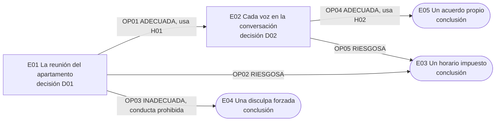
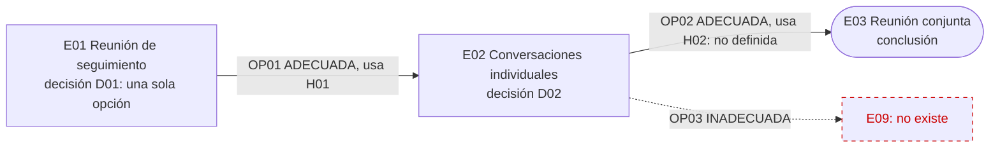

# Fase 4 — Validación del DSL: un caso válido, un caso con errores y el validador

| | |
|---|---|
| **Taller** | Diseño de un DSL para la Gestión de Casos Situacionales del Simulador de Psicología Social |
| **Asignatura** | Ingeniería de Software II |
| **Equipo** | Juan José Sua Gómez y Emerson Ángel Gómez (fases 1, 3 y 4) |
| **Entregable** | 3 — DSL: `simulador_psicologia_social.json`, con el escenario válido y el escenario con errores |
| **Archivos** | `simulador_psicologia_social.json`, `validador/validar_dsl.py`, `validador/test_validar_dsl.py` y este documento; apoyo: `validador/probar_las_pruebas.py`, `validador/estres_aleatorio.py` y las salidas `validador/salida-*.txt` |
| **Parte de** | `fase-1-modelo-dominio.md` (modelo), `fase-3-sintaxis-concreta.md` y `dsl-casos.schema.json` (sintaxis) |
| **Versión** | 11 de octubre de 2026 |

---

## 0. Qué contiene este documento y dónde está cada cosa

| Lo que pide la Fase 4 del enunciado | Dónde está |
|---|---|
| Representar dos escenarios con el DSL diseñado | §2 y `simulador_psicologia_social.json` |
| Escenario 1, caso válido: 2 personajes, 2 escenas, 1 decisión, 2 opciones, 1 herramienta, 1 retroalimentación | §2.2 (tabla «mínimo pedido frente a entregado») |
| Escenario 2, caso con errores: al menos tres reglas OCL incumplidas | §2.3 y §3 |
| Actividad de análisis: tabla Error, Regla incumplida, Elemento afectado, Posible solución | §3 |
| Entregable: archivo `simulador_psicologia_social.json` con los dos escenarios | Raíz de esta carpeta; estructura en §2.1 |
| Procedimiento seguido | §1 |
| Resultado real de ejecutar el validador y las pruebas | §4 (pegado tal como salió) |
| Cómo volver a ejecutar todo | §5 |
| Cierre reflexivo del enunciado (§7) | §7 |

**Los dos escenarios en una frase.** El escenario 1 es un caso de convivencia en un apartamento compartido, publicado y con un intento ya ejecutado, que pasa las 17 comprobaciones del validador (la forma y las 16 reglas); el escenario 2 es un borrador de conflicto en un equipo de trabajo con cinco errores deliberados (OCL-02, OCL-03, OCL-05, OCL-06 y OCL-07), cada uno en un solo elemento y sin efectos en cadena.

**El validador en una frase.** Valida siempre en dos capas, la forma del documento según `dsl-casos.schema.json` y después 16 reglas semánticas (las ocho OCL del enunciado y ocho propuestas del equipo), imprime por escenario la regla, el estado, el elemento afectado y el mensaje, y termina con un código de salida distinto de cero si un escenario no dio el resultado que se esperaba de él.

**Numeración de las reglas.** Igual que en las fases 1 y 3, `OCL-01` a `OCL-08` son las ocho reglas que lista el enunciado en la Fase 2, en su orden; las que propone el equipo se numeran `PROP-01` a `PROP-08` y están marcadas como **PROPUESTA** en el informe. Las rutas de archivo de este documento son relativas a esta carpeta.

---

## 1. Procedimiento

### 1.1 Pasos

| N.º | Paso | Resultado |
|---|---|---|
| 1 | Partir del modelo (Fase 1) y de la sintaxis (Fase 3): 16 clases, esquema JSON y reglas OCL-01 a OCL-08 en el orden del enunciado | Vocabulario y reglas fijados antes de escribir casos |
| 2 | Escribir el escenario 1 con el DSL, con una historia propia de convivencia, y comprobar que supera los mínimos del enunciado | `escenarios[0]` |
| 3 | Escribir el escenario 2 con otra historia (equipo de trabajo) y romper a propósito cinco reglas, **una por elemento** y sin que un error arrastre a otro | `escenarios[1]` |
| 4 | Construir un validador en dos capas, con una función por regla, y ejecutarlo sobre los dos escenarios | §4.1 |
| 5 | Analizar el escenario con errores: qué falla, dónde y cómo se corrige | §3 |
| 6 | Comprobar que las soluciones propuestas corrigen el caso (se aplican por código y el caso pasa a válido) | §3.3 |
| 7 | Probar el validador: el caso válido pasa, el caso con errores falla exactamente en lo previsto y 44 mutaciones del caso válido incumplen cada una su regla y solo esa | §4.2 |
| 8 | Probar las pruebas: romper cada regla a propósito y comprobar que alguna prueba lo detecta | §4.3 |

### 1.2 Cómo valida el validador

```
archivo.json ──► ¿lista de escenarios o documento único?
                         │
                         ▼  (por cada documento DSL)
      capa 1: FORMA        intérprete de dsl-casos.schema.json (solo biblioteca estándar)
                           claves, tipos, enumeraciones, formato de id, claves desconocidas,
                           INV-12, INV-19, RN-03 ...
      capa 2: SEMÁNTICA    OCL-01 a OCL-08 (enunciado) y PROP-01 a PROP-08 (propuestas)
                         │
                         ▼
      informe por escenario: regla, estado, elemento afectado, mensaje
                         │
                         ▼
      ¿el resultado coincide con el «tipo» declarado?  ──►  código de salida 0 / 1 / 2
```

- **Las dos capas se ejecutan siempre**, aunque la primera falle (Fase 3, §6.3). Por eso las funciones de las reglas están escritas para no fallar con un documento mal formado: lo informan.
- **El esquema se interpreta con código propio** (`InterpreteEsquema`), de modo que el validador funciona con solo la biblioteca estándar. Si `jsonschema` está instalado, se usa además como **comprobación cruzada**: el informe dice si su veredicto coincide con el del intérprete. Si no está, esa línea se omite y el resultado no cambia (degradación elegante).
- **Detección del formato.** Un objeto con `escenarios` es una lista de escenarios `{id, nombre, tipo, caso}`; un objeto con `escenas` o `versionDsl` es un documento DSL único; una lista JSON se trata como lista de escenarios o de documentos. Cualquier otra forma sale con código 2.

### 1.3 Estados y veredicto

| Estado | Significado |
|---|---|
| `CUMPLE` | La regla se evaluó sobre al menos un elemento y ninguno la infringe |
| `INCUMPLE` | Al menos un elemento infringe la regla; el informe lista cada uno |
| `NO_APLICA` | La regla no tiene sobre qué evaluarse (por ejemplo, un caso sin intentos para las reglas de bitácora). No se da por cumplida: se dice por qué |
| `NO_EVALUADA` | Solo para FORMA, cuando no se encontró el esquema; el informe lo avisa |

El veredicto de un escenario es **válido** si ninguna regla `INCUMPLE`, y **con-errores** en caso contrario. Se compara con el campo `tipo` del escenario:

| Situación | Código de salida |
|---|---|
| Todos los escenarios dieron el resultado esperado | 0 |
| Un escenario esperado `valido` falla, o uno esperado `con-errores` no falla | 1 |
| Archivo inexistente, JSON roto, forma no reconocida, `tipo` desconocido o `versionDsl` distinta de la declarada | 2 |

Un documento único no trae `tipo`: se espera `valido` salvo que se pase `--esperar con-errores`.

### 1.4 Decisiones de diseño del validador

| N.º | Decisión | Razón |
|---|---|---|
| V-01 | **Un error que el esquema atribuye a una de OCL-01 a OCL-08 se cuenta una sola vez, bajo esa regla.** Los errores del esquema con `x-regla` OCL-01 a OCL-08 (`escenas`, `opciones` de una decisión, `siguienteEscena`, `titulo`, `descripcion` y el `oneOf` de la retroalimentación) no se repiten en FORMA: los informa la función de esa regla. Lo demás se informa en FORMA y, si una regla semántica ve el mismo defecto, también en ella; son dos capas que miran lo mismo (por ejemplo, `escenaInicial` con formato inválido da FORMA `[INV-09]` y PROP-02, y `herramienta: "H1"` da FORMA y OCL-05). El informe muestra ambos y `incumplimientos` cuenta cada aparición | Si no, una decisión con una opción contaría como dos incumplimientos (esquema y OCL-02). Para lo demás no se oculta nada: cada capa debe poder informar sola, sin esquema o cuando la regla semántica no se evalúa (sin escenas, PROP-02 no aplica y solo FORMA ve que falta `escenaInicial`) |
| V-02 | `NO_APLICA` en lugar de `CUMPLE` vacío; y OCL-08, PROP-02 y PROP-06 **no se evalúan** si el caso no tiene escenas | Un caso sin escenas tampoco tiene decisiones ni camino, pero eso ya lo informa OCL-01; repetirlo atribuiría un error a dos reglas |
| V-03 | OCL-04 se formula sobre el caso: ninguna escena puede reutilizar el identificador de decisión de otra. **Acuerdo para el equipo de la Fase 2:** `context Caso`, `self.escenas->select(e \| e.decision->notEmpty())->collect(e \| e.decision)->isUnique(id)`; el modelo no tiene `Escena.decisiones` | Una escena presenta como máximo una decisión (0..1), así que «dos decisiones con el mismo identificador en una escena» es imposible por estructura; el sentido de la regla es que los identificadores no se confundan (Fase 1, nota de INV-04) |
| V-04 | OCL-06 exige exactamente una asociación (`decision` u `opcion`) **y** que lo asociado exista | Es la lectura de la Fase 1 (INV-06, XOR) y la de la Fase 3 (§6.2): sin destino válido no se sabría a qué explica la retroalimentación |
| V-05 | OCL-05 se evalúa por opción: «usada dentro de una escena» es «nombrada por una opción de la decisión de esa escena» | En el DSL la herramienta se usa con `opciones[].herramienta` (R-10) |
| V-06 | Un texto de solo espacios cuenta como vacío (OCL-07) | Un título en blanco no identifica un caso |
| V-07 | La capa de forma informa, junto al error, la regla del dominio que el esquema hace cumplir (`[INV-12]`, `[INV-19]`, `[RN-03]`) | Que quien lea el informe sepa qué regla se infringió sin abrir el esquema |
| V-08 | Cada escenario trae su resultado esperado en `tipo` | El código de salida compara lo obtenido con lo esperado, no solo «hay errores» |

### 1.5 Las 16 reglas semánticas

Cada una es una función de `validador/validar_dsl.py` con su expresión OCL y su descripción en el *docstring*. Los nombres de rol de las expresiones son los del modelo de la Fase 1; en el JSON, `escenaDestino` es `siguienteEscena` y `herramientaUsada` es `herramienta` (Fase 3, §2.5).

| Regla | Tipo | Qué exige | Expresión OCL (resumen) | Función | Fase 1 |
|---|---|---|---|---|---|
| OCL-01 | Enunciado | Un caso contiene al menos una escena | `self.escenas->size() >= 1` | `ocl_01_caso_con_escena` | INV-01 |
| OCL-02 | Enunciado | Una decisión tiene como mínimo dos opciones | `self.opciones->size() >= 2` | `ocl_02_decision_con_dos_opciones` | INV-02 |
| OCL-03 | Enunciado | Una opción referencia una escena existente | `self.decision.escena.caso.escenas->includes(self.escenaDestino)` | `ocl_03_opcion_con_escena_existente` | INV-03 |
| OCL-04 | Enunciado | Una escena no tiene dos decisiones con el mismo identificador (leída sobre el caso, V-03) | `self.escenas->select(e \| e.decision->notEmpty())->collect(e \| e.decision)->isUnique(id)` | `ocl_04_decisiones_sin_identificador_repetido` | INV-04 |
| OCL-05 | Enunciado | La herramienta usada en una escena está definida en el caso | `self.herramientaUsada->notEmpty() implies self.decision.escena.caso.herramientas->includes(self.herramientaUsada)` | `ocl_05_herramienta_definida_en_el_caso` | INV-05 |
| OCL-06 | Enunciado | Una retroalimentación está asociada a una decisión u opción | `self.decision->notEmpty() xor self.opcion->notEmpty()` | `ocl_06_retroalimentacion_asociada` | INV-06 |
| OCL-07 | Enunciado | Un caso tiene título y descripción | `self.titulo.trim().size() > 0 and self.descripcion.trim().size() > 0` (`trim()`: un texto de solo espacios cuenta como vacío, V-06) | `ocl_07_caso_con_titulo_y_descripcion` | INV-07 |
| OCL-08 | Enunciado | Un caso contiene al menos un punto de decisión | `self.escenas->exists(e \| e.decision->notEmpty())` | `ocl_08_caso_con_punto_de_decision` | INV-08 |
| PROP-01 | **Propuesta** | Ningún identificador se repite en el documento, sea cual sea el tipo de elemento, incluido el del caso aunque nada lo referencie (los de decisión los cubre OCL-04) | `todos->isUnique(i \| i)`, con `todos` la unión de los `id` de todas las clases menos `Decision` | `prop_01_identificadores_unicos` | INV-13 |
| PROP-02 | **Propuesta** | La escena inicial existe y toda escena es alcanzable desde ella | `self.escenas->includes(self.escenaInicial)` y `self.escenaInicial.siguientes->closure(siguientes)` cubre todas las escenas (`siguientes`: Fase 1, §6.2) | `prop_02_escenas_alcanzables` | INV-09, INV-11 |
| PROP-03 | **Propuesta** | Los personajes que participan en una escena están definidos en el caso | `self.caso.personajes->includesAll(self.participantes)` | `prop_03_personajes_existentes` | INV-14 |
| PROP-04 | **Propuesta** | La opción elegida en la bitácora pertenece a la decisión de la escena en que estaba el intento | `self.opcionElegida.decision.escena = self.escenaEnCurso`. `escenaEnCurso` no es un rol del modelo: es derivada, se reconstruye desde `escenaInicial` aplicando, en orden, las opciones de los registros con `aplicada = true` | `prop_04_opcion_pertenece_a_su_decision` | INV-18 |
| PROP-05 | **Propuesta** | El registro de la bitácora es coherente: opciones que existen, `orden` 1, 2, 3…, momentos que no retroceden ni salen del intervalo del intento (ninguno es posterior al cierre: la bitácora ya está bloqueada), una reflexión por escena, `escenaActual` que concuerda con el recorrido, un intento COMPLETADO que termina en una conclusión y se cierra en el momento de su última decisión aplicada, y uno abierto que no ha llegado a una conclusión | `self.decisiones->sortedBy(orden)->collect(orden) = Sequence{1..self.decisiones->size()}` y otras siete (PROP05a a PROP05h) | `prop_05_bitacora_coherente` | INV-17, INV-18 |
| PROP-06 | **Propuesta** | El flujo no contiene ciclos | `not self.siguientes->closure(siguientes)->includes(self)` | `prop_06_flujo_aciclico` | INV-10 |
| PROP-07 | **Propuesta** | La rúbrica del caso existe y las evaluaciones aplican esa rúbrica (un caso sin rúbrica no tiene cuál aplicar), activa; valoran criterios de ella, sin repetir, y cubren todos si están EVALUADAS; la valoración del SISTEMA no es anterior al cierre del intento | `self.valoraciones->forAll(v \| self.rubrica.criterios->includes(v.criterio))` y otras cuatro (PROP07b a PROP07e) | `prop_07_evaluacion_coherente_con_la_rubrica` | INV-20 |
| PROP-08 | **Propuesta** | Los intentos son de estudiantes del documento y ninguno tiene dos intentos abiertos | `self.intentos->select(abierto)->isUnique(caso)` | `prop_08_un_intento_abierto_por_estudiante` | INV-16 |

**Por qué las ocho propuestas están justificadas.**

| Regla | Qué error evita si no existe |
|---|---|
| PROP-01 | Una referencia por identificador deja de ser inequívoca; dos escenas `E05` hacen que «ir a E05» no signifique nada |
| PROP-02 | Contenido que el estudiante nunca verá y que nadie revisaría; también una escena inicial que no existe |
| PROP-03 | Escenas con personas que el caso no describe |
| PROP-04 | Un registro que cita la opción de otra decisión describe un recorrido que el caso no permite |
| PROP-05 | Una bitácora que se contradice (orden saltado, reflexiones duplicadas o escritas después del cierre, estado terminado en una escena con decisión, o abierto en una conclusión) no sirve para reportes ni para evaluar |
| PROP-06 | Un ciclo permite un caso que no termina; sin él, un caso válido siempre llega a una conclusión (Fase 3, §5.2) |
| PROP-07 | Una evaluación que aplica una rúbrica que el caso no tiene o que no está activa, que valora criterios ajenos, que dice estar completa sin estarlo o que el sistema hizo antes de que el intento se cerrara |
| PROP-08 | Dos intentos abiertos del mismo caso hacen ambiguo el «continuar desde el último punto» (RN-06, RN-07) |

---

## 2. Los dos escenarios

### 2.1 Estructura del archivo

`simulador_psicologia_social.json` es un único archivo con la forma que sugiere el enunciado y un documento DSL completo (el de la Fase 3) dentro de cada escenario:

```json
{
  "dsl": { "nombre": "DSL de casos situacionales de SIEP", "version": "1.0", "esquema": "dsl-casos.schema.json" },
  "escenarios": [
    { "id": "ESCENARIO-1", "nombre": "...", "tipo": "valido",      "descripcion": "...", "caso": { "versionDsl": "1.0", "caso": {...}, "personajes": [...], ... } },
    { "id": "ESCENARIO-2", "nombre": "...", "tipo": "con-errores", "descripcion": "...", "caso": { "versionDsl": "1.0", "caso": {...}, "personajes": [...], ... } }
  ]
}
```

| Clave | Qué contiene |
|---|---|
| `dsl` | Nombre y versión del lenguaje (y el esquema que lo define). La versión debe coincidir con `versionDsl` de cada documento |
| `escenarios[].id`, `.nombre` | Identificador y nombre del escenario (no son identificadores del DSL) |
| `escenarios[].tipo` | `valido` o `con-errores`: lo que el validador espera encontrar |
| `escenarios[].descripcion` | Qué se pretende con el escenario |
| `escenarios[].caso` | El documento DSL completo. Se puede extraer tal cual y validar con `dsl-casos.schema.json` |

### 2.2 Escenario 1 — caso válido: convivencia en un apartamento compartido

**La historia.** Tres estudiantes comparten apartamento. Daniela madruga por sus prácticas y no ha dicho con claridad que el ruido nocturno le impide descansar; Esteban trabaja de noche y siente que lo acusan sin conocer sus horarios; Valentina evita el conflicto y calla. El estudiante actúa como practicante de bienestar universitario y debe facilitar la reunión sin tomar partido. Es un caso sobrio, de convivencia, sin contenido clínico.

**Mínimo pedido frente a entregado.**

| Mínimo del enunciado | Entregado |
|---|---|
| 2 personajes | 3: `P01` Daniela, `P02` Esteban, `P03` Valentina |
| 2 escenas | 5: `E01` a `E05` (2 con decisión y 3 conclusiones) |
| 1 decisión | 2: `D01` (3 opciones) y `D02` (2 opciones) |
| 2 opciones | 5: `OP01` a `OP05` |
| 1 herramienta | 2: `H01` Mapa de actores e intereses y `H02` Acuerdo de convivencia |
| 1 retroalimentación | 4: `R01` y `R04` de una decisión, `R02` y `R03` de una opción |

**Flujo del caso.**



**Qué muestra del DSL.**

| Concepto | Dónde está en el caso | Referencia (línea base, modelo y Fase 1) |
|---|---|---|
| Ramificación: cada opción de `D01` lleva a una escena distinta | `OP01`, `OP02` y `OP03` | RF-09 |
| Convergencia: dos opciones de decisiones distintas llegan a la misma escena | `OP02` y `OP05` hacia `E03` | RF-09 |
| Conclusión: una escena sin `decision` | `E03`, `E04` y `E05` | RF-09 |
| Decisión con las opciones que la situación necesita (más de dos) | `D01` con tres | RN-11 |
| Ayudas o pistas | `D01.pistas` (2) y `D02.pistas` (1) | RF-11, RF-18 |
| Consecuencia inmediata, al elegir | `opciones[].consecuencia` | RN-08 |
| Retroalimentación pedagógica con fundamento teórico, al terminar | `R01` a `R04` | RF-10, RF-23, RN-08 |
| Retroalimentación de una decisión y de una opción | `R01`, `R04` (decisión); `R02`, `R03` (opción) | RF-10 |
| Herramienta usada por una opción | `OP01` con `H01`; `OP04` con `H02` | R-10 |
| Conducta prohibida con su motivo | `OP03` | INV-12 |
| Rúbrica formativa, sin nota | `RUB-01` con tres criterios | RF-22, RN-09 |
| Bitácora con una decisión no aplicada | `INT-01`: registro 1 (`OP02`, `aplicada: false`), registro 2 (`OP01`), registro 3 (`OP04`) | RF-20, RF-21 |
| Reflexiones del estudiante (una por escena) | `INT-01`: `E01` y `E02` | RF-20 |
| Evaluación formativa por criterio | `EV-01`: `LOGRADO`, `EN_PROCESO`, `DESTACADO` | RF-22, RN-09 |

El caso está `PUBLICADO` y trae un intento `COMPLETADO` que recorre `E01`, queda en `E01` tras una elección riesgosa que el simulador pide reconsiderar y termina en `E05`. El intento se cierra a las 15:07:05, en el instante de su última decisión (`OP04`), que es cuando SIEP lo cierra y bloquea la bitácora: por eso la última reflexión es de las 15:06:40 y la valoración del sistema, de las 15:07:06.

### 2.3 Escenario 2 — caso con errores: reproches en un equipo de trabajo por un informe atrasado

**La historia.** El informe trimestral lleva tres días de retraso. Camila (coordinadora) le reprocha a Julián, delante del equipo, que no cumplió su parte; Julián responde que recibió los datos incompletos y que además cubrió el trabajo de un compañero ausente. Es otra historia a propósito: así los errores no se confunden con los del escenario 1. El documento es un **borrador** (`BORRADOR`, versión `0.9.0`) que el autor dejó incompleto.

**Flujo del caso, con lo que está mal.**



**Los cinco errores deliberados.**

| N.º | Qué se hizo en el JSON | Regla | Elemento |
|---|---|---|---|
| 1 | `D01` se dejó con una sola opción (`OP01`) | OCL-02 | Decisión `D01` |
| 2 | `OP03` conduce a `siguienteEscena: "E09"` y no existe una escena `E09` | OCL-03 | Opción `OP03` |
| 3 | `OP02` usa `herramienta: "H02"` y el catálogo solo define `H01` | OCL-05 | Opción `OP02` |
| 4 | `R02` no trae `decision` ni `opcion` | OCL-06 | Retroalimentación `R02` |
| 5 | `caso.descripcion` es `""` | OCL-07 | Caso `CASO-002` |

**Cómo se evitó que un error arrastrara a otro.** El enunciado pide que cada error sea atribuible a un solo elemento. Se cuidó de dos maneras:

- Los destinos rotos no dejan escenas huérfanas: `E09` no existe, pero `E01`, `E02` y `E03` siguen siendo alcanzables, así que PROP-02 se cumple.
- Ninguna retroalimentación cita lo roto: `R01` cita `OP01` y `R03` cita `D02`, que existen. Por eso corregir un error nunca depende de otro.

Los efectos en cadena que sí pueden aparecer cuando se rompe un caso se documentan y se prueban aparte (§4.2, «Efectos en cadena»).

---

## 3. Análisis del escenario con errores

### 3.1 Tabla de análisis

Las tres primeras filas son las del ejemplo del enunciado, con su redacción; las dos últimas completan el análisis.

| Error | Regla incumplida | Elemento afectado | Posible solución |
|---|---|---|---|
| Decisión con una opción | OCL-02 | Decisión `D01` (escena `E01`) | Agregar otra opción a `D01`, por ejemplo intervenir de inmediato en la reunión, con una escena de destino existente |
| Herramienta inexistente | OCL-05 | Opción `OP02` (usa `H02`) | Registrar la herramienta `H02` («Acta de acuerdos») en `herramientas`, o quitar `herramienta` de la opción |
| Escena inexistente | OCL-03 | Opción `OP03` (`siguienteEscena: "E09"`) | Referenciar una escena válida, por ejemplo `E03`, o crear la escena `E09` con su contenido |
| Retroalimentación sin decisión ni opción | OCL-06 | Retroalimentación `R02` | Asociarla a la opción `OP03` (su mensaje explica por qué atribuir el retraso a una sola persona es inadecuado) |
| Caso sin descripción | OCL-07 | Caso `CASO-002` (`caso.descripcion`) | Redactar la descripción: el contexto de la situación y el rol del estudiante |

### 3.2 Lo que el escenario sí cumple

Corregir lo que falla no debe hacer pensar que el resto sobra. El validador informa, para el escenario 2:

| Estado | Reglas |
|---|---|
| `INCUMPLE` (5) | OCL-02, OCL-03, OCL-05, OCL-06, OCL-07 |
| `CUMPLE` (8) | FORMA, OCL-01, OCL-04, OCL-08, PROP-01, PROP-02, PROP-03, PROP-06 |
| `NO_APLICA` (4) | PROP-04, PROP-05, PROP-07 y PROP-08, porque el borrador no trae intentos, bitácora ni rúbrica |

La forma del documento (FORMA) cumple en el sentido del validador: no queda ningún error de forma que no esté ya atribuido a una regla OCL (decisión V-01). Conviene no leerlo de más. Tres de los cinco errores **también se ven en el esquema solo**, porque la Fase 3 (§6.2) hace cumplir esas reglas con una restricción de forma: validado con `jsonschema` directamente, el escenario 2 da cuatro errores del esquema (`minItems` en `D01`, para OCL-02; `oneOf` en `R02`, para OCL-06; y `minLength` y `pattern` en `caso.descripcion`, para OCL-07). Los otros dos, OCL-03 y OCL-05, tienen **forma válida** (`E09` y `H02` son identificadores bien formados) y solo se detectan en la capa semántica, porque hay que mirar otra parte del documento para saber que no existen. Es el reparto de la Fase 3 (§6.1 y §6.4).

### 3.3 Las soluciones sí corrigen el caso

La prueba `test_las_soluciones_propuestas_dejan_el_caso_sin_errores` aplica por código las cinco soluciones de la tabla (agregar `OP04` a `D01`, apuntar `OP03` a `E03`, registrar `H02`, asociar `R02` a `OP03` y escribir la descripción) y comprueba que el validador deja de informar incumplimientos y el veredicto pasa a `valido`.

---

## 4. Resultado real de la ejecución

Ejecutado el 11 de octubre de 2026 con Python 3.13.5 (`C:/Python313/python.exe -I -B`; `-B` evita la carpeta `__pycache__`) y `jsonschema` 4.25.1, desde la carpeta `validador/`. Las salidas completas están en `validador/salida-validador.txt`, `salida-validador.json`, `salida-pruebas.txt`, `salida-probar-las-pruebas.txt` y `salida-estres.txt`.

### 4.1 El validador sobre `simulador_psicologia_social.json`

Comando: `C:/Python313/python.exe -I -B validar_dsl.py ..\simulador_psicologia_social.json`. Código de salida: **0**.

```text
Validador del DSL de casos situacionales de SIEP (Fase 4)
============================================================================
Archivo : ..\simulador_psicologia_social.json
Formato : lista de escenarios (2) - DSL «DSL de casos situacionales de SIEP» versión 1.0
Esquema : ..\dsl-casos.schema.json
Jsonschema: 4.25.1 - comprobación cruzada de la forma: coincide en todos los escenarios
Reglas  : FORMA + 8 OCL del enunciado + 8 PROPUESTAS por el equipo

============================================================================
ESCENARIO-1: Escenario 1. Caso válido: convivencia en un apartamento compartido
Esperado: valido
Caso CASO-001 «Convivencia en un apartamento compartido» (PUBLICADO): 3
personajes, 5 escenas (2 con decisión), 5 opciones, 2 herramientas, 4
retroalimentaciones, 1 intento
----------------------------------------------------------------------------
Regla    Tipo       Estado      Eval.  Descripción
-------- ---------- ----------- -----  ----------------------------------------------------
FORMA    FORMA      CUMPLE          -  Forma del documento según dsl-casos.schema.json
OCL-01   OCL        CUMPLE          1  Un caso debe contener al menos una escena.
OCL-02   OCL        CUMPLE          2  Una decisión debe tener como mínimo dos opciones.
OCL-03   OCL        CUMPLE          5  Una opción de decisión debe referenciar una escena existente.
OCL-04   OCL        CUMPLE          2  Una escena no puede tener dos decisiones con el mismo identificador.
OCL-05   OCL        CUMPLE          2  Una herramienta utilizada dentro de una escena debe estar previamente
                                       definida en el caso.
OCL-06   OCL        CUMPLE          4  Una retroalimentación debe estar asociada a una decisión u opción de
                                       decisión.
OCL-07   OCL        CUMPLE          2  Un caso debe tener un título y una descripción.
OCL-08   OCL        CUMPLE          1  Un caso debe contener al menos un punto de decisión.
PROP-01  PROPUESTA  CUMPLE         28  Ningún identificador se repite en el documento (unicidad global).
PROP-02  PROPUESTA  CUMPLE          5  La escena inicial existe y toda escena es alcanzable desde ella.
PROP-03  PROPUESTA  CUMPLE         15  Los personajes que participan en una escena están definidos en el caso.
PROP-04  PROPUESTA  CUMPLE          3  La opción elegida en la bitácora pertenece a la decisión de la escena en
                                       que estaba el intento.
PROP-05  PROPUESTA  CUMPLE          1  El registro de la bitácora es coherente con el caso y con el intento.
PROP-06  PROPUESTA  CUMPLE          5  El flujo del caso no contiene ciclos.
PROP-07  PROPUESTA  CUMPLE          2  La rúbrica del caso existe y las evaluaciones la aplican de forma
                                       coherente.
PROP-08  PROPUESTA  CUMPLE          1  Los intentos son de estudiantes del documento y ninguno tiene dos
                                       abiertos.
----------------------------------------------------------------------------
Resultado: VÁLIDO. Ninguna regla se incumple.
Expectativa (valido): se cumple.

============================================================================
ESCENARIO-2: Escenario 2. Caso con errores: reproches en un equipo de trabajo por un informe atrasado
Esperado: con-errores
Caso CASO-002 «Reproches en un equipo de trabajo por un informe atrasado»
(BORRADOR): 2 personajes, 3 escenas (2 con decisión), 3 opciones, 1
herramienta, 3 retroalimentaciones, 0 intentos
----------------------------------------------------------------------------
Regla    Tipo       Estado      Eval.  Descripción
-------- ---------- ----------- -----  ----------------------------------------------------
FORMA    FORMA      CUMPLE          -  Forma del documento según dsl-casos.schema.json
OCL-01   OCL        CUMPLE          1  Un caso debe contener al menos una escena.
OCL-02   OCL        INCUMPLE        2  Una decisión debe tener como mínimo dos opciones.
         - Elemento: Decisión D01
           Mensaje: La decisión de la escena E01 tiene una sola opción; se exigen al menos 2.
           Ruta:    escenas[0].decision.opciones
OCL-03   OCL        INCUMPLE        3  Una opción de decisión debe referenciar una escena existente.
         - Elemento: Opción OP03
           Mensaje: La opción conduce a la escena «E09», que no existe en el caso.
           Ruta:    escenas[1].decision.opciones[1].siguienteEscena
OCL-04   OCL        CUMPLE          2  Una escena no puede tener dos decisiones con el mismo identificador.
OCL-05   OCL        INCUMPLE        2  Una herramienta utilizada dentro de una escena debe estar previamente
                                       definida en el caso.
         - Elemento: Opción OP02
           Mensaje: La herramienta «H02» que usa la opción (decisión D02, escena E02) no está
           definida en las herramientas del caso.
           Ruta:    escenas[1].decision.opciones[0].herramienta
OCL-06   OCL        INCUMPLE        3  Una retroalimentación debe estar asociada a una decisión u opción de
                                       decisión.
         - Elemento: Retroalimentación R02
           Mensaje: No está asociada a ninguna decisión ni opción; se exige exactamente una de las
           dos.
           Ruta:    retroalimentacion[1]
OCL-07   OCL        INCUMPLE        2  Un caso debe tener un título y una descripción.
         - Elemento: Caso CASO-002
           Mensaje: La descripción del caso falta o está vacía.
           Ruta:    caso.descripcion
OCL-08   OCL        CUMPLE          1  Un caso debe contener al menos un punto de decisión.
PROP-01  PROPUESTA  CUMPLE         13  Ningún identificador se repite en el documento (unicidad global).
PROP-02  PROPUESTA  CUMPLE          3  La escena inicial existe y toda escena es alcanzable desde ella.
PROP-03  PROPUESTA  CUMPLE          6  Los personajes que participan en una escena están definidos en el caso.
PROP-04  PROPUESTA  NO_APLICA       -  La opción elegida en la bitácora pertenece a la decisión de la escena en
                                       que estaba el intento.
                                       (no aplica: el documento no trae decisiones registradas en una bitácora)
PROP-05  PROPUESTA  NO_APLICA       -  El registro de la bitácora es coherente con el caso y con el intento.
                                       (no aplica: el documento no trae intentos (ejecucion))
PROP-06  PROPUESTA  CUMPLE          3  El flujo del caso no contiene ciclos.
PROP-07  PROPUESTA  NO_APLICA       -  La rúbrica del caso existe y las evaluaciones la aplican de forma
                                       coherente.
                                       (no aplica: el caso no declara rúbrica y no trae evaluaciones)
PROP-08  PROPUESTA  NO_APLICA       -  Los intentos son de estudiantes del documento y ninguno tiene dos
                                       abiertos.
                                       (no aplica: el documento no trae intentos (ejecucion))
----------------------------------------------------------------------------
Resultado: CON ERRORES. 5 incumplimiento(s) en 5 regla(s): OCL-02, OCL-03, OCL-05, OCL-06, OCL-07.
Expectativa (con-errores): se cumple.

============================================================================
RESUMEN
Escenario      Esperado     Obtenido     Incumpl.  Reglas incumplidas / expectativa
ESCENARIO-1    valido       valido              0  - -> OK
ESCENARIO-2    con-errores  con-errores         5  OCL-02, OCL-03, OCL-05, OCL-06, OCL-07 -> OK
Código de salida: 0
```

**Códigos de salida comprobados con ejecuciones reales.**

| Ejecución | Resultado | Código |
|---|---|---|
| `validar_dsl.py ..\simulador_psicologia_social.json` | Los dos escenarios dan lo esperado | **0** |
| El mismo archivo con los `tipo` invertidos (copia temporal) | `ESCENARIO-1  con-errores  valido  0  - -> FALLA` y `ESCENARIO-2  valido  con-errores  5  OCL-02, OCL-03, OCL-05, OCL-06, OCL-07 -> FALLA` | **1** |
| `validar_dsl.py no-existe.json` | `Error: No existe el archivo: no-existe.json` | **2** |
| `validar_dsl.py ..\ejemplo-minimo.json` (el documento de referencia de la Fase 3, como documento único) | `DOCUMENTO-1  valido  valido  0  - -> OK` | **0** |

### 4.2 Las pruebas

Comando: `C:/Python313/python.exe -I -B test_validar_dsl.py -v`. Código de salida: **0**.

```text
test_archivo_inexistente_json_roto_o_forma_desconocida_salen_con_codigo_2 (__main__.ArchivoYCodigoDeSalida.test_archivo_inexistente_json_roto_o_forma_desconocida_salen_con_codigo_2) ... ok
test_basta_un_escenario_inesperado_entre_varios (__main__.ArchivoYCodigoDeSalida.test_basta_un_escenario_inesperado_entre_varios) ... ok
test_detecta_la_lista_de_escenarios_y_el_documento_unico (__main__.ArchivoYCodigoDeSalida.test_detecta_la_lista_de_escenarios_y_el_documento_unico) ... ok
test_documento_unico_se_espera_valido_salvo_que_se_indique_otra_cosa (__main__.ArchivoYCodigoDeSalida.test_documento_unico_se_espera_valido_salvo_que_se_indique_otra_cosa) ... ok
test_el_archivo_entregado_sale_con_codigo_0 (__main__.ArchivoYCodigoDeSalida.test_el_archivo_entregado_sale_con_codigo_0) ... ok
test_el_informe_en_texto_trae_regla_estado_elemento_y_mensaje (__main__.ArchivoYCodigoDeSalida.test_el_informe_en_texto_trae_regla_estado_elemento_y_mensaje) ... ok
test_la_salida_json_es_legible_por_maquina (__main__.ArchivoYCodigoDeSalida.test_la_salida_json_es_legible_por_maquina) ... ok
test_sin_el_archivo_del_esquema_el_informe_avisa_que_no_comprobo_la_forma (__main__.ArchivoYCodigoDeSalida.test_sin_el_archivo_del_esquema_el_informe_avisa_que_no_comprobo_la_forma) ... ok
test_sin_jsonschema_da_el_mismo_veredicto_por_la_linea_de_comandos (__main__.ArchivoYCodigoDeSalida.test_sin_jsonschema_da_el_mismo_veredicto_por_la_linea_de_comandos) ... ok
test_un_escenario_esperado_con_errores_que_no_falla_sale_con_codigo_1 (__main__.ArchivoYCodigoDeSalida.test_un_escenario_esperado_con_errores_que_no_falla_sale_con_codigo_1) ... ok
test_un_escenario_esperado_valido_que_falla_sale_con_codigo_1 (__main__.ArchivoYCodigoDeSalida.test_un_escenario_esperado_valido_que_falla_sale_con_codigo_1) ... ok
test_una_version_del_dsl_distinta_de_la_del_archivo_sale_con_codigo_2 (__main__.ArchivoYCodigoDeSalida.test_una_version_del_dsl_distinta_de_la_del_archivo_sale_con_codigo_2) ... ok
test_documentos_mal_formados_no_hacen_fallar_a_las_reglas (__main__.CapaDeForma.test_documentos_mal_formados_no_hacen_fallar_a_las_reglas) ... ok
test_el_interprete_coincide_con_jsonschema_en_todos_los_documentos (__main__.CapaDeForma.test_el_interprete_coincide_con_jsonschema_en_todos_los_documentos) ... ok
test_sin_esquema_la_forma_no_se_evalua_pero_las_reglas_siguen (__main__.CapaDeForma.test_sin_esquema_la_forma_no_se_evalua_pero_las_reglas_siguen) ... ok
test_sin_jsonschema_el_resultado_es_el_mismo (__main__.CapaDeForma.test_sin_jsonschema_el_resultado_es_el_mismo) ... ok
test_un_documento_que_no_es_un_objeto_se_informa_sin_fallar (__main__.CapaDeForma.test_un_documento_que_no_es_un_objeto_se_informa_sin_fallar) ... ok
test_la_opcion_que_el_intento_uso_no_se_puede_quitar_sin_que_la_bitacora_lo_note (__main__.EfectosEnCadena.test_la_opcion_que_el_intento_uso_no_se_puede_quitar_sin_que_la_bitacora_lo_note) ... ok
test_quitar_una_opcion_que_otra_cita_deja_la_cita_colgada_y_una_escena_inalcanzable (__main__.EfectosEnCadena.test_quitar_una_opcion_que_otra_cita_deja_la_cita_colgada_y_una_escena_inalcanzable) ... ok
test_cada_error_se_atribuye_a_un_solo_elemento_y_es_el_correcto (__main__.EscenarioConErrores.test_cada_error_se_atribuye_a_un_solo_elemento_y_es_el_correcto) ... ok
test_el_resto_de_las_reglas_cumple_o_no_aplica (__main__.EscenarioConErrores.test_el_resto_de_las_reglas_cumple_o_no_aplica) ... ok
test_incluye_las_tres_reglas_que_pide_el_enunciado (__main__.EscenarioConErrores.test_incluye_las_tres_reglas_que_pide_el_enunciado) ... ok
test_incumple_exactamente_las_reglas_previstas (__main__.EscenarioConErrores.test_incumple_exactamente_las_reglas_previstas) ... ok
test_las_soluciones_propuestas_dejan_el_caso_sin_errores (__main__.EscenarioConErrores.test_las_soluciones_propuestas_dejan_el_caso_sin_errores) ... ok
test_los_errores_no_arrastran_otras_reglas (__main__.EscenarioConErrores.test_los_errores_no_arrastran_otras_reglas) ... ok
test_cumple_los_minimos_que_pide_el_enunciado (__main__.EscenarioValido.test_cumple_los_minimos_que_pide_el_enunciado) ... ok
test_es_valido_para_el_esquema_oficial_de_jsonschema (__main__.EscenarioValido.test_es_valido_para_el_esquema_oficial_de_jsonschema) ... ok
test_pasa_las_diecisiete_reglas_sin_ninguna_no_aplica (__main__.EscenarioValido.test_pasa_las_diecisiete_reglas_sin_ninguna_no_aplica) ... ok
test_toda_decision_tiene_al_menos_dos_opciones (__main__.EscenarioValido.test_toda_decision_tiene_al_menos_dos_opciones) ... ok
test_cada_mutacion_incumple_la_regla_correspondiente_y_solo_esa (__main__.MutacionesDelCasoValido.test_cada_mutacion_incumple_la_regla_correspondiente_y_solo_esa) ... ok
test_la_regla_de_forma_muestra_la_regla_del_dominio_que_infringe (__main__.MutacionesDelCasoValido.test_la_regla_de_forma_muestra_la_regla_del_dominio_que_infringe) ... ok
test_las_mutaciones_cubren_las_ocho_reglas_ocl_y_las_ocho_propuestas (__main__.MutacionesDelCasoValido.test_las_mutaciones_cubren_las_ocho_reglas_ocl_y_las_ocho_propuestas) ... ok
test_sin_escena_inicial_el_recorrido_no_se_reconstruye_y_prop_04_no_se_da_por_cumplida (__main__.MutacionesDelCasoValido.test_sin_escena_inicial_el_recorrido_no_se_reconstruye_y_prop_04_no_se_da_por_cumplida) ... ok
test_sin_escenas_las_reglas_que_dependen_de_ellas_no_se_evaluan (__main__.MutacionesDelCasoValido.test_sin_escenas_las_reglas_que_dependen_de_ellas_no_se_evaluan) ... ok
test_cada_regla_documenta_su_expresion_ocl_en_el_docstring (__main__.ReglasComoCodigo.test_cada_regla_documenta_su_expresion_ocl_en_el_docstring) ... ok
test_hay_una_funcion_por_regla (__main__.ReglasComoCodigo.test_hay_una_funcion_por_regla) ... ok
test_las_propuestas_estan_marcadas_y_son_ocho (__main__.ReglasComoCodigo.test_las_propuestas_estan_marcadas_y_son_ocho) ... ok
test_las_reglas_ocl_son_las_ocho_del_enunciado_en_su_orden (__main__.ReglasComoCodigo.test_las_reglas_ocl_son_las_ocho_del_enunciado_en_su_orden) ... ok
test_decision_nula_no_cuenta_como_punto_de_decision_en_el_esquema (__main__.Robustez.test_decision_nula_no_cuenta_como_punto_de_decision_en_el_esquema) ... ok
test_los_mensajes_no_muestran_restos_de_python (__main__.Robustez.test_los_mensajes_no_muestran_restos_de_python) ... ok
test_ningun_formato_termina_en_un_dolar_que_admita_un_salto_de_linea (__main__.Robustez.test_ningun_formato_termina_en_un_dolar_que_admita_un_salto_de_linea) ... ok
test_un_ciclo_se_informa_con_la_opcion_que_lo_cierra (__main__.Robustez.test_un_ciclo_se_informa_con_la_opcion_que_lo_cierra) ... ok
test_un_flujo_de_miles_de_escenas_encadenadas_no_agota_la_pila (__main__.Robustez.test_un_flujo_de_miles_de_escenas_encadenadas_no_agota_la_pila) ... ok
test_un_salto_de_linea_final_tampoco_pasa_el_esquema_oficial (__main__.Robustez.test_un_salto_de_linea_final_tampoco_pasa_el_esquema_oficial) ... ok
test_un_valor_nulo_se_informa_una_sola_vez_por_la_forma_cuando_la_regla_no_lo_evalua (__main__.Robustez.test_un_valor_nulo_se_informa_una_sola_vez_por_la_forma_cuando_la_regla_no_lo_evalua) ... ok
test_una_decision_sin_la_clave_opciones_se_informa_solo_en_ocl_02 (__main__.Robustez.test_una_decision_sin_la_clave_opciones_se_informa_solo_en_ocl_02) ... ok

----------------------------------------------------------------------
Ran 46 tests in 0.455s

OK
```

**Qué cubre cada grupo de pruebas.**

| Clase de pruebas | Pruebas | Qué comprueba |
|---|---|---|
| `EscenarioValido` | 4 | Pasa las 17 filas del informe (FORMA, 8 OCL y 8 propuestas) sin una sola `NO_APLICA`; supera los mínimos del enunciado; es válido también para el `jsonschema` oficial |
| `EscenarioConErrores` | 6 | Incumple **exactamente** OCL-02, OCL-03, OCL-05, OCL-06 y OCL-07; cada una con un solo hallazgo, el elemento y la ruta correctos; lo demás cumple o no aplica; las soluciones propuestas lo dejan válido |
| `MutacionesDelCasoValido` | 5 | 44 mutaciones del caso válido, cada una incumple su regla y solo esa (tabla siguiente); cubren las 17 reglas; sin escenas, las reglas que dependen de ellas no se evalúan; sin escena inicial, PROP-04 no se da por cumplida |
| `EfectosEnCadena` | 2 | Una rotura que arrastra otras las arrastra de forma previsible |
| `ReglasComoCodigo` | 4 | Las 8 OCL son las del enunciado en su orden; cada regla trae su expresión OCL en el *docstring*; hay 8 propuestas y una función por regla |
| `CapaDeForma` | 5 | El intérprete coincide con `jsonschema` en los 46 documentos de prueba; sin esquema o sin `jsonschema` el resultado se sostiene; documentos mal formados no tumban las reglas |
| `ArchivoYCodigoDeSalida` | 12 | Formatos de archivo, códigos 0, 1 y 2, salida JSON, aviso cuando falta el esquema |
| `Robustez` | 8 | Un flujo de 1500 escenas encadenadas no agota la pila; un ciclo se informa con su camino; los valores nulos no dejan restos de Python en los mensajes ni se informan dos veces; `decision: null` no cuenta como punto de decisión en el esquema; una decisión sin la clave `opciones` se informa solo en OCL-02; ningún formato termina en `$`; un salto de línea final no pasa el esquema |

**Mutaciones del caso válido** (`MutacionesDelCasoValido`). Cada mutación rompe una sola cosa del escenario 1 y la prueba exige que el conjunto de reglas incumplidas sea exactamente la indicada y que el elemento afectado sea el que se señala. Las filas 24 a 27, 31 a 33 y 42 a 44 son las que agregó la revisión del 11 de octubre.

| N.º | Mutación | Regla | Elemento afectado |
|---|---|---|---|
| 1 | Sin escenas (y sin lo que dependía de ellas) | OCL-01 | Caso `CASO-001` |
| 2 | Decisión `D02` con una sola opción | OCL-02 | Decisión `D02` |
| 3 | `siguienteEscena` inexistente | OCL-03 | Opción `OP05` |
| 4 | Opción sin `siguienteEscena` | OCL-03 | Opción `OP05` |
| 5 | Identificador de decisión repetido | OCL-04 | Decisión `D01` (escena `E03`) |
| 6 | Herramienta no definida (`H99`) | OCL-05 | Opción `OP01` |
| 7 | Retroalimentación sin referencia | OCL-06 | Retroalimentación `R01` |
| 8 | Retroalimentación con decisión y opción | OCL-06 | Retroalimentación `R01` |
| 9 | Retroalimentación hacia una decisión inexistente | OCL-06 | Retroalimentación `R01` |
| 10 | Título vacío | OCL-07 | Caso `CASO-001` |
| 11 | Sin descripción | OCL-07 | Caso `CASO-001` |
| 12 | Ninguna escena con decisión | OCL-08 | Caso `CASO-001` |
| 13 | Herramienta con identificador repetido | PROP-01 | Herramienta `H01` |
| 14 | Escena con identificador repetido | PROP-01 | Escena `E05` |
| 15 | Escena inalcanzable | PROP-02 | Escena `E06` |
| 16 | Escena inicial inexistente | PROP-02 | Caso `CASO-001` |
| 17 | Personaje inexistente en una escena | PROP-03 | Escena `E01` |
| 18 | Opción registrada de otra decisión | PROP-04 | Registro de decisión 1 del intento `INT-01` |
| 19 | Orden de registro repetido | PROP-05 | Registro de decisión en la posición 3 del intento `INT-01` |
| 20 | Opción registrada inexistente | PROP-05 | Registro de decisión 2 del intento `INT-01` |
| 21 | Escena actual incoherente con el recorrido | PROP-05 | Intento `INT-01` |
| 22 | Dos reflexiones para una escena | PROP-05 | Reflexión sobre la escena `E01` del intento `INT-01` |
| 23 | Momento anterior al inicio del intento | PROP-05 | Registro de decisión 1 del intento `INT-01` |
| 24 | Intento que termina antes de empezar | PROP-05 | Intento `INT-01` |
| 25 | Intento completado que cierra después de su última decisión | PROP-05 | Intento `INT-01` |
| 26 | Reflexión posterior al cierre del intento | PROP-05 | Reflexión sobre la escena `E02` del intento `INT-01` |
| 27 | Intento abierto que ya llegó a una conclusión | PROP-05 | Intento `INT-01` |
| 28 | Ciclo en el flujo | PROP-06 | Opción `OP06` |
| 29 | Evaluación EVALUADA sin cubrir los criterios | PROP-07 | Evaluación `EV-01` |
| 30 | Rúbrica del caso inexistente | PROP-07 | Caso `CASO-001` |
| 31 | Evaluación con una rúbrica y caso sin rúbrica | PROP-07 | Evaluación `EV-01` |
| 32 | Evaluación con una rúbrica inactiva | PROP-07 | Evaluación `EV-01` |
| 33 | Valoración del sistema anterior al cierre del intento | PROP-07 | Evaluación `EV-01` |
| 34 | Dos intentos abiertos del mismo estudiante | PROP-08 | Estudiante `EST-01` |
| 35 | Intento de un estudiante inexistente | PROP-08 | Intento `INT-01` |
| 36 | Nota numérica en la evaluación | FORMA | Evaluación `EV-01` |
| 37 | Conducta prohibida sin motivo | FORMA `[INV-12]` | Opción `OP02` |
| 38 | Bitácora abierta en un intento completado | FORMA `[INV-19]` | Bitácora `BIT-01` |
| 39 | Intentos con el caso en `BORRADOR` | FORMA `[RN-03]` | Caso `CASO-001` |
| 40 | Atributo derivado `esConclusion` escrito | FORMA | Escena `E03` |
| 41 | `decision: null` en una conclusión | FORMA | Escena `E03` |
| 42 | `herramienta: null` | FORMA | Opción `OP01` |
| 43 | Identificador de caso con salto de línea final | FORMA | Caso `CASO-001` |
| 44 | `siguienteEscena: null` | OCL-03 | Opción `OP05` |

**Efectos en cadena.** Cuando una rotura sí arrastra otras reglas, el validador las informa y la prueba fija cuáles son (Fase 3, §6.4):

| Rotura | Reglas que fallan | Por qué |
|---|---|---|
| Quitar `OP03` de `D01` (queda con dos opciones) | OCL-06 y PROP-02 | `R03` cita a `OP03`, que ya no existe; y `E04` solo se alcanzaba por `OP03` |
| Quitar `OP04` de `D02` | OCL-02, PROP-02 y PROP-05 | `D02` queda con una opción; `E05` queda inalcanzable; y la bitácora del intento cita una opción que ya no existe |

### 4.3 Comprobación de que las pruebas no son vacuas

Una suite que siempre pasa no prueba nada. `probar_las_pruebas.py` rompe el validador a propósito, una regla a la vez y de dos formas (la regla siempre cumple o siempre falla), y cuenta cuántas pruebas fallan. Comando: `C:/Python313/python.exe -I -B probar_las_pruebas.py`. Código de salida: **0**.

```text
Línea base, sin romper nada: 46 pruebas, 0 fallan.

Regla    Rotura          Pruebas que fallan  Detectada
-------- --------------- ------------------  ---------
OCL-01   siempre-cumple                   1  sí
...
Validador restaurado: 46 pruebas, 0 fallan.
Roturas detectadas: 32 de 32.
```

La tabla completa (32 filas) está en `validador/salida-probar-las-pruebas.txt`. Cada una de las 16 reglas, rota en cualquiera de las dos formas, hace fallar al menos una prueba: de 1 a 63. La cuenta incluye cada caso de las pruebas con subpruebas (`subTest`), por eso puede superar las 46 pruebas.

### 4.4 Prueba de estrés con mutaciones aleatorias

`estres_aleatorio.py` aplica de una a tres alteraciones al azar (borrar una clave, poner un valor de otro tipo, duplicar un elemento) a los dos casos y valida cada documento resultante. Con la semilla fija, siempre es la misma serie. Comando: `C:/Python313/python.exe -I -B estres_aleatorio.py`. Código de salida: **0**.

```text
Documentos alterados: 4000 (semilla 20261010)
Comparados con jsonschema: 4000; discrepancias: 0
Errores internos de las reglas: 0
Combinaciones distintas de reglas incumplidas: 198
```

El intérprete de forma y `jsonschema` coinciden en los 4000 documentos y ninguna regla falló por dentro con un documento roto.

---

## 5. Cómo volver a ejecutar

Todo se ejecuta desde la carpeta `validador/`. Solo hace falta Python 3; `jsonschema` es opcional. **`C:/Python313/python.exe` es la instalación del equipo donde se ejecutó; en otro equipo se usa `python` o `python3`.** `-I` aísla el intérprete del entorno y `-B` evita que escriba una carpeta `__pycache__` junto a los scripts.

| Qué | Comando |
|---|---|
| Validar los dos escenarios | `C:/Python313/python.exe -I -B validar_dsl.py ..\simulador_psicologia_social.json` |
| Lo mismo en JSON, legible por máquina | `C:/Python313/python.exe -I -B validar_dsl.py ..\simulador_psicologia_social.json --json` |
| Sin `jsonschema`, aunque esté instalado | `C:/Python313/python.exe -I -B validar_dsl.py ..\simulador_psicologia_social.json --sin-jsonschema` |
| Un documento DSL único, esperado con errores | `C:/Python313/python.exe -I -B validar_dsl.py mi-caso.json --esperar con-errores` |
| Otro esquema | `C:/Python313/python.exe -I -B validar_dsl.py mi-caso.json --esquema ..\dsl-casos.schema.json` |
| Las pruebas | `C:/Python313/python.exe -I -B test_validar_dsl.py -v` |
| Probar las pruebas | `C:/Python313/python.exe -I -B probar_las_pruebas.py` |
| Estrés aleatorio (cantidad y semilla opcionales) | `C:/Python313/python.exe -I -B estres_aleatorio.py 4000 20261010` |

**Notas.**

- Sin argumento de archivo, `validar_dsl.py` valida `..\simulador_psicologia_social.json`.
- Con `-I`, Python no agrega la carpeta del script a `sys.path`; por eso los scripts se invocan por su nombre de archivo (no con `-m`) y los de prueba agregan su carpeta ellos mismos. Sin `-I` funcionan igual.
- Los *scripts* reconfiguran su salida a UTF-8, de modo que las tildes salen bien aunque se redirija a un archivo; si la consola de Windows las muestra mal, `-X utf8` o `chcp 65001` lo resuelven.
- El esquema se busca junto al script, en la carpeta superior y en la carpeta actual.

**Para agregar una regla.** Se escribe una función `def prop_09_...(doc)` que reciba el documento y devuelva `Resultado(evaluados, hallazgos)` (o `Resultado(no_aplica="motivo")`), con el *docstring* `PROP-09. <descripción>` seguido de la expresión OCL, y se decora con `@regla("PROP-09", "PROPUESTA", inv="...")`. Entra sola en el informe y en la salida JSON. Las pruebas esperan 16 reglas: se actualiza `test_hay_una_funcion_por_regla` y se agrega al menos una mutación.

**Para validar un caso propio.** Se pega en un archivo con la forma del documento DSL (Fase 3: `versionDsl`, `caso`, `escenas`, ...) y se ejecuta con el comando de «un documento DSL único». Si el archivo agrupa varios casos, cada uno va como `{id, nombre, tipo, caso}` dentro de `escenarios`.

---

## 6. Verificación y límites

**Qué se verificó** (todo ejecutado, no supuesto):

1. `simulador_psicologia_social.json` es JSON válido. Validados directamente con `dsl-casos.schema.json` y `jsonschema`, el escenario 1 no da ningún error del esquema y el escenario 2 da cuatro, todos los que corresponden a OCL-02, OCL-06 y OCL-07 (§3.2); OCL-03 y OCL-05 no son visibles al esquema.
2. El escenario 1 pasa las 17 filas del informe; el escenario 2 incumple exactamente las cinco reglas previstas, cada una con un solo hallazgo en el elemento correcto.
3. 44 mutaciones del caso válido incumplen cada una su regla y solo esa; los efectos en cadena están documentados y probados.
4. El intérprete de forma coincide con `jsonschema` 4.25.1 en los 46 documentos de las pruebas y en 4000 documentos aleatorios.
5. Al romper cada regla a propósito, de dos formas, alguna prueba falla (32 de 32 roturas detectadas).
6. El validador acepta como documento válido el `ejemplo-minimo.json` de la Fase 3, que se escribió antes y por separado.
7. Los dos diagramas Mermaid de §2 se renderizaron en un navegador con Mermaid 11.4.1 y no dieron errores; el diagrama de clases de la Fase 1 también.

**Qué no se verificó.**

- **Las reglas OCL no se ejecutaron con una herramienta OCL.** Las funciones del validador son una implementación en Python de lo que dicen las reglas; las expresiones de los *docstrings* son las del esbozo de la Fase 1 (§6.2). La Fase 2 la entregan otros compañeros: si su redacción difiere, hay que actualizar los *docstrings*; los identificadores `OCL-01` a `OCL-08` coinciden por convención de orden.
- **OCL-04 tiene una lectura propia** (V-03). El enunciado dice «una escena no puede tener dos decisiones con el mismo identificador»; como el DSL permite una decisión por escena, la regla se leyó sobre el caso. Si la Fase 2 la formula distinto, el validador debe seguirla.
- **Las ocho propuestas son decisiones del equipo**, no reglas del enunciado. Están marcadas y se pueden quitar sin tocar las demás.
- **No se probó con otras versiones de Python** (solo 3.13.5) ni con otro validador de JSON Schema distinto de `jsonschema`.
- **El validador no mira entre versiones**: que una versión publicada no se edite (INV-15) exige comparar dos documentos y queda fuera.
- **Dos escenarios son una muestra, no una cobertura del dominio.** La cobertura de las reglas la dan las 44 mutaciones; los escenarios muestran el uso.
- **No se construyó importador ni exportador a SIEP**; la correspondencia está en la Fase 3 (§7).
- **`aplicada` no se comprueba contra la regla de reconsideración del motor.** La primera respuesta riesgosa, inadecuada o prohibida de una escena no avanza (Fase 1, §7.4); eso es política del simulador, no del DSL. El validador reconstruye el recorrido con lo que el documento declara en `aplicada`: un registro con `aplicada` inconsistente con esa política pasa, salvo que el recorrido que resulta contradiga otra regla (PROP-04).
- **Las fechas imposibles pasan la forma.** Una fecha como `2026-02-31T10:00:00-05:00` cumple el formato y el verificador de formatos de `jsonschema` de este entorno no incluye `date-time`; el validador no puede interpretarla y omite en silencio las comprobaciones de tiempo de PROP-05 y PROP-07 para ese valor (Fase 3, §10).
---

## 7. Cierre reflexivo

El DSL permite escribir un caso de psicología social como un documento estructurado en lugar de como pantallas, texto suelto o filas de una base de datos, y el ejercicio dejó ver tres cosas que eso trae. Primero, la creación: los conceptos del dominio (caso, escena, decisión, opción, herramienta, retroalimentación, bitácora) tienen un lugar y un nombre únicos, de modo que dos personas escriben el mismo caso de la misma forma. Segundo, la validación: las reglas de negocio dejan de ser una convención que cada docente recuerda y pasan a ser comprobaciones que se ejecutan en segundos; el escenario con errores no es «malo» por intuición, sino porque cinco reglas concretas señalan cinco elementos concretos con una solución cada una. Tercero, la evolución: como el lenguaje está versionado y cada regla es una función separada, agregar una regla (por ejemplo, que toda decisión tenga retroalimentación) o una clave nueva no obliga a reescribir los casos existentes. Los límites son igual de claros. El DSL y el validador comprueban que un caso está bien formado, no que sea bueno: ninguna regla dice si una opción está bien clasificada como adecuada ni si el fundamento teórico es pertinente, y eso sigue dependiendo del criterio docente. Las reglas se implementaron en Python como referencia y no se ejecutaron con una herramienta OCL; algunas decisiones, como la lectura de OCL-04 o las ocho reglas propuestas, son del equipo y la Fase 2 puede ajustarlas; la inmutabilidad de una versión publicada exige comparar versiones, fuera de un documento; y SIEP hoy no tiene importación ni exportación de casos, así que el DSL describe el camino hacia el simulador real y no una integración ya hecha.
